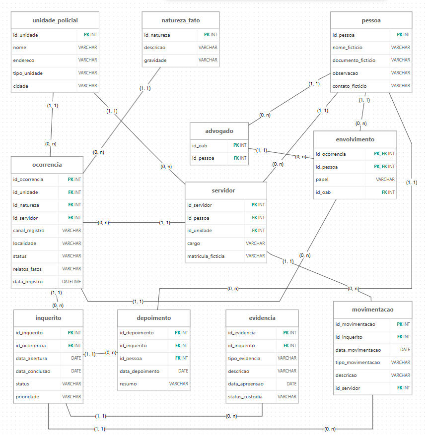

# Modelagem de Banco de Dados para o 52º Distrito Policial de São Paulo

Relatório Técnico Final — Entrega 2 (modelo lógico, implementação SQL e apresentação final).

## Integrantes

| Nome completo do aluno | RGM | Usuário do GitHub |
|---|---|---|
| Enzo Freire dos Santos | 47806303 | [enzofreire-cmd](https://github.com/enzofreire-cmd) |
| Eduardo Vinicius Ribeiro Costa | 48693855 | [EduardoRibeiro-007](https://github.com/EduardoRibeiro-007) |
| Giovanna Ribeiro Souza | 47952822 | [gioribeirro](https://github.com/gioribeirro) |
| João Victor da Costa Silva | 49227238 | [Thevic69](https://github.com/Thevic69) |
| Paulo Henrique Camilo de Pascoa Souza | 47806745 | [phpascoa](https://github.com/phpascoa) |

**Convenções de origem usadas neste documento:** *relatado* = dito na entrevista; *documentado* = registrado pelo grupo nos artefatos; *modelado* = decisão de modelagem; *implementado* = presente no script `db_52dp.sql`; *fictício* = dado da massa de testes, sem valor estatístico sobre a unidade.

## Índice de artefatos

| Artefato | Arquivo |
|---|---|
| Levantamento de campo | [SegundaParteDoTrabalho/levantamento.md](SegundaParteDoTrabalho/levantamento.md) |
| Evidências (fotos e áudio) | [Registro 1](PrimeiraParteDoTrabalho/Registro%201.jpeg), [Registro 2](PrimeiraParteDoTrabalho/Registro%202.jpeg), [Registro 3](PrimeiraParteDoTrabalho/Registro%203.jpeg), [Áudio](PrimeiraParteDoTrabalho/Audio%20da%20entrevista%201.mp4) |
| DER conceitual | [Der.png](PrimeiraParteDoTrabalho/DER%20Modelo%20Conceitual.png) |
| Modelo lógico (diagrama) | [PrimeiraParteDoTrabalho/modelo_logico.png](PrimeiraParteDoTrabalho/modelo_logico.png) |
| Documentação do modelo lógico e da normalização | [SegundaParteDoTrabalho/Modelo_Logico_Documentacao.html](SegundaParteDoTrabalho/Modelo_Logico_Documentacao.html) |
| Dicionário de Dados (11 entidades, 56 atributos) | [PrimeiraParteDoTrabalho/Dicionario_de_Dados_52_DP.html](PrimeiraParteDoTrabalho/Dicionario_de_Dados_52_DP.html) |
| Script SQL complementar (massa de dados, consultas gerenciais G01–G19, verificações V01–V11, views de BI) | [SegundaParteDoTrabalho/db_52dp.sql](SegundaParteDoTrabalho/db_52dp.sql) |
| Script SQL unificado (estrutura, carga-base, consultas, `UPDATE` e `DELETE` com `ROLLBACK`) | [SegundaParteDoTrabalho/Script_SQL_52DP.sql](SegundaParteDoTrabalho/Script_SQL_52DP.sql) |
| Prefixos de nomenclatura dos atributos | [PrimeiraParteDoTrabalho/prefixos_dicionario_52_dp%20.html](PrimeiraParteDoTrabalho/prefixos_dicionario_52_dp%20.html) |
| Modelo conceitual e levantamento (Entrega 1) | [SegundaParteDoTrabalho/modelo-conceitual-e-levantamento.html](SegundaParteDoTrabalho/modelo-conceitual-e-levantamento.html) |

---

## 1. Relatório Técnico Final

### 1.1 Revisão do Modelo Conceitual

#### Caracterização da organização

| Item | Descrição |
|---|---|
| Organização | 52º Distrito Policial de São Paulo (Polícia Civil do Estado de São Paulo) |
| Natureza | Instituição pública, sem fins lucrativos |
| Endereço | [R. Dr. Coryntho Baldoíno Costa, 400 – Vila Zilda, São Paulo – SP, 03069-070](https://maps.app.goo.gl/KpnnQxBFQmJx874c8) (abre no Google Maps) |
| Contato institucional | Telefone da unidade: (11) 2293-6036 |
| Atividade | Registro de ocorrências e condução de inquéritos policiais (instrução, depoimentos, evidências, movimentações e conclusão) |
| Canais de registro | Presencial e online (relatado) |

**Porte e volume (relatados na entrevista).**

- **Escrivães:** 6, usados apenas em inquéritos.
- **Registro de ocorrências:** feito pelo entrevistado e por mais um colega; os escrivães não registram ocorrências.
- **Análise dos boletins:** o delegado titular analisa o boletim de ocorrência e instaura o inquérito.
- **Carga:** 200 a 300 inquéritos por mês para cada delegado, "dependendo do lugar". O valor foi preservado como relatado, sem conversão em inquéritos abertos ou concluídos por mês.
- **Ocorrências:** o número cresce a cada ano e não é previsível por mês, porque existem registro físico e online.

**Limites do levantamento.** O levantamento não traz uma série mensal de boletins de ocorrência nem o total de servidores da unidade, por isso nenhum número foi atribuído a esses itens. O banco de testes usa uma composição fictícia de 10 servidores (6 escrivães, 2 delegados e 2 investigadores/agentes), definida para exercitar as consultas, e não descreve a lotação real.

**Problemas e necessidades (Pxx).** Todos são problemas de gestão de informações e têm ao menos uma consulta gerencial na matriz da seção 1.6.

| Código | Problema | Origem | Contribuição do modelo |
|---|---|---|---|
| P1 | O DESP, sistema estadual, cai com frequência e dificulta o registro e o acompanhamento. | Relatado | Base relacional autocontida e consultável sem depender do DESP. Não substitui nem corrige a instabilidade do DESP. |
| P2 | Os casos precisam ser acompanhados do registro da ocorrência à abertura, à instrução e à conclusão do inquérito. | Relatado (P1, P6, P8, P9, C11) | Separa OCORRENCIA de INQUERITO e registra status, datas e movimentações. |
| P3 | O volume de ocorrências cresce e não é previsível por mês, com dois canais de entrada. | Relatado (C10) | `canal_registro` e `data_registro` permitem medir tendência e participação por canal. |
| P4 | Padrões de natureza se repetem (estelionato, golpe do amor, falsa delegacia) e a unidade precisa enxergá-los. | Relatado (P5, P10) | NATUREZA_FATO classifica cada ocorrência; `localidade` permite recortes por local. |
| P5 | A carga de trabalho é alta (200 a 300 inquéritos por mês por delegado, 6 escrivães) e a distribuição entre servidores não é visível. | Relatado (C13, C14) | MOVIMENTACAO liga cada ato do inquérito ao servidor responsável. |
| P6 | A instrução (depoimentos, evidências, movimentações) e o acompanhamento por vítima e por advogado do acusado precisam de controle estruturado. | Relatado (P8, P9) | DEPOIMENTO, EVIDENCIA e ENVOLVIMENTO (com `id_oab`) estruturam esses registros. |

**Escopo do sistema.** O banco cobre todo o ciclo documentado na unidade: cadastro de unidade, servidores e pessoas; registro de ocorrências com natureza e envolvidos; abertura de inquérito; depoimentos, evidências, movimentações e conclusão. Não cobre autenticação, controle de acesso em tempo de execução, interface de usuário nem integração com o DESP.

**Justificativa da escolha.** O 52º DP é uma instituição pública com processos definidos (registro, conversão, instrução, conclusão), com acesso presencial a servidores da unidade e com volume de informação que sustenta um modelo relacional de várias entidades. Nenhum integrante declarou vínculo profissional ou familiar com a unidade.

**Evidências da organização.** Fotos da fachada e da visita (arquivos JPG no repositório), localização no [Google Maps](https://maps.app.goo.gl/KpnnQxBFQmJx874c8), endereço completo e telefone institucional (tabela acima). Fotos e áudio estão na seção "Relato da entrevista".

**Responsável pela organização.** A agente entrevistada não autorizou a divulgação do nome nem forneceu contato pessoal. Contato para confirmação: telefone institucional da unidade, (11) 2293-6036.

#### Relato da entrevista

O levantamento completo está em [SegundaParteDoTrabalho/levantamento.md](SegundaParteDoTrabalho/levantamento.md). Resumo:

| Item | Registro |
|---|---|
| Quem | Agente da unidade, com 35 anos de atuação na área policial (nome não autorizado para divulgação). Complemento (C10, C11, C13, C14): servidor que atua no registro de ocorrências, cujo nome não consta dos registros do grupo. |
| Integrantes presentes | Giovanna Ribeiro Souza elaborou as perguntas, conduziu a maior parte da entrevista e anotou as respostas em tempo real. Três integrantes aparecem nas fotografias; os registros não identificam quais. |
| 1ª visita | 04/09/2026, no 52º DP: entrevista principal (P1 a P10 e observações adicionais). |
| 2ª visita | 24/09/2026, no 52º DP: complemento das informações (C10, C11, C13, C14). Áudio de 2 min 36 s gravado por volta das 17h22. |
| Horários registrados | 17h10 e 16h09. O levantamento não associa cada horário a uma visita. |
| Onde | Ambiente do 52º DP; a entrevista ocorreu em local aberto, em frente à delegacia, próximo ao estacionamento. |

**Achados das respostas (relatados).**

- O inquérito serve para apurar os fatos, ouvir os dois lados e verificar a veracidade das informações (P1).
- A ocorrência é registrada com imparcialidade; anotam-se relatos e fatos, principalmente os ocorridos no momento da situação (P2, P3).
- Qualquer pessoa autorizada dentro da delegacia registra; quem comunica pode ser a vítima ou qualquer pessoa que conheça os fatos (P4).
- Os registros são muito frequentes, principalmente de estelionato, com padrões fixos como golpe do amor e falsa delegacia (P5).
- Só há conversão em inquérito com prova materializada; sem ela, o caso permanece em investigação (C11). O delegado titular analisa o boletim e instaura o inquérito ao identificar indícios de crime (P7, P10). Se a materialidade não for comprovada, o procedimento pode ser cancelado (P2).
- Depoimentos e evidências são registrados no inquérito físico e no digital; escrivão e delegado são responsáveis (P8).
- A vítima pode acompanhar o andamento; o acusado só por meio de advogado (P9).
- O DESP abrange todo o estado e cai constantemente.
- Opinião da agente, sem efeito no modelo: algumas ocorrências não deveriam ir à delegacia e seria útil um espaço de apoio para relatos de menor gravidade.

**Achados da observação presencial (separados das respostas).** O grupo viu apenas a recepção. Não havia grande movimentação no horário, e escrivães e outros profissionais não estavam na recepção. As fotografias mostram porta de vidro com balcão ao fundo, rampa com piso tátil e sinalização de acessibilidade, bancos de concreto e o banner da delegacia. Nenhum dos processos descritos neste relatório foi observado em execução: todos decorrem das respostas.

**O que mudou da Entrega 1 para a Entrega 2.** Não houve perguntas novas em campo além do bloco complementar (C10, C11, C13, C14), que já constava na Entrega 1. As mudanças vieram das respostas e de revisões de modelagem (tabela "Revisão e alterações conceituais", mais abaixo).

**Comprovação (fotos e áudio).**

<a href="PrimeiraParteDoTrabalho/Audio%20da%20entrevista%201.mp4" target="_blank">
  Registro em Áudio
</a>
<br>
<br>
<p align="center">
  
  <br>
  <a href="PrimeiraParteDoTrabalho/Registro%201.jpeg">Registro da Entrevista 1</a>
</p>

<br>

<p align="center">
  
  <br>
  <a href="PrimeiraParteDoTrabalho/Registro%202.jpeg">Registro da Entrevista 2</a>
</p>

<br>

<p align="center">
  
  <br>
  <a href="PrimeiraParteDoTrabalho/Registro%203.jpeg">Registro da Entrevista 3</a>
</p>

O áudio é evidência complementar; o texto de referência da pesquisa de campo é o [levantamento.md](SegundaParteDoTrabalho/levantamento.md).

#### Processos de negócio

Os processos abaixo foram levantados nas respostas da entrevista. Os dados citados são os atributos do script `db_52dp.sql`.

| Processo | Etapas e dados envolvidos |
|---|---|
| **Registro de ocorrência** | Um servidor autorizado registra a ocorrência: unidade (`id_unidade`), natureza do fato (`id_natureza`), servidor (`id_servidor`), canal (`canal_registro`: Presencial ou Online), data e hora (`data_registro`), local do fato (`localidade`), situação (`status`) e relato imparcial (`relato_fatos`). Na prática descrita em C14, quem registra são o entrevistado e mais um colega. |
| **Vínculo de pessoas** | Cada pessoa (nome, documento, contato e observação em PESSOA) é ligada à ocorrência com o papel que exerce (`papel` em ENVOLVIMENTO: Vítima, Testemunha, Acusado, Comunicante). Para o acusado, pode-se registrar o advogado vinculado (`id_oab`). |
| **Análise e conversão** | O delegado analisa o boletim. Com prova materializada, a ocorrência passa a `Convertida em inquérito` e gera um INQUERITO (`data_abertura`, `status`, `prioridade`). Sem prova, permanece `Em investigação`; pode ficar `Em análise` ou ser `Cancelada`. |
| **Instrução** | Escrivão e delegado registram depoimentos (pessoa, `data_depoimento`, `resumo_ficticio`) e evidências (`tipo_evidencia`, `descricao`, `data_apreensao`, `status_custodia`). |
| **Movimentação** | Cada ato do inquérito (distribuição, instauração, oitiva, juntada, despacho, relatório final etc.) é registrado com data, tipo, descrição e servidor responsável (Delegado ou Escrivão). |
| **Acompanhamento** | A vítima acompanha o andamento diretamente; o acusado, por meio de advogado. O banco guarda o vínculo `id_oab`; a concessão de acesso ocorre fora do banco. |
| **Conclusão** | O inquérito é encerrado com `status` e `data_conclusao` (igual ou posterior a `data_abertura`). |

**Processos típicos não incluídos.** Gestão de custódia física de bens, escala de equipe e comunicação com outros órgãos não foram modelados porque não foram levantados na entrevista. O grupo não afirma que a unidade não os execute.

#### Requisitos funcionais

| Código | Requisito | Entidades e dados |
|---|---|---|
| RF01 | Registrar ocorrência com unidade, servidor responsável, natureza do fato, canal de registro, data e hora, localidade, situação e relato dos fatos. | OCORRENCIA |
| RF02 | Vincular uma ou mais pessoas a uma ocorrência, com o papel de cada uma. | PESSOA, ENVOLVIMENTO |
| RF03 | Abrir inquérito a partir de uma ocorrência, somente quando houver prova materializada, com data de abertura, situação e prioridade. | INQUERITO |
| RF04 | Registrar depoimentos de um inquérito, com a pessoa que depôs, a data e o resumo. | DEPOIMENTO |
| RF05 | Registrar evidências de um inquérito, com tipo, descrição, data de apreensão e situação da cadeia de custódia. | EVIDENCIA |
| RF06 | Registrar movimentações de um inquérito, com data, tipo, descrição e servidor responsável. | MOVIMENTACAO |
| RF07 | Consultar a situação de uma ocorrência ou de um inquérito. | OCORRENCIA, INQUERITO |
| RF08 | Gerar relatórios gerenciais (ocorrências por natureza e por canal, inquéritos por situação e demais consultas G01 a G19). | Consultas e views `vw_bi_*` |
| RF09 | Atualizar a situação e a data de conclusão de um inquérito. | INQUERITO |
| RF10 | Registrar o advogado vinculado a uma pessoa acusada em uma ocorrência. | ENVOLVIMENTO, ADVOGADO |

RF01 a RF06 e RF10 correspondem a estruturas de armazenamento implementadas. RF07 e RF08 correspondem às consultas e views. RF09 é exercitado pelo teste de `UPDATE` do [script unificado](SegundaParteDoTrabalho/Script_SQL_52DP.sql), na seção 7 do arquivo.

**Requisitos típicos não incluídos.** Autenticação e perfis de acesso, integração com o DESP, notificações a vítimas e interface de usuário ficaram fora: são requisitos de aplicação, não de modelagem de dados, e não foram levantados com a unidade.

#### Requisitos não funcionais

| Código | Requisito | Situação |
|---|---|---|
| RNF01 | Disponibilidade contínua, para reduzir a dependência da instabilidade do DESP. | Requisito de projeto; depende de infraestrutura. O script não o implementa. |
| RNF02 | Integridade dos registros, sem alterações retroativas sem rastreabilidade. | Integridade referencial e `CHECK` implementadas. Trilha de auditoria de alterações não implementada. |
| RNF03 | Segurança e privacidade: acesso restrito e auditável a dados de vítimas, testemunhas e servidores. | Requisito de projeto. A matriz de acesso do dicionário é proposta; o script não cria perfis nem permissões. |
| RNF04 | Rastreabilidade: toda movimentação registra data e servidor responsável. | Implementado com `data_movimentacao` (tipo `DATE`, sem hora) e `id_servidor`. |
| RNF05 | Usabilidade: registro simples para qualquer servidor autorizado. | Requisito de interface; não há interface implementada. |
| RNF06 | Escalabilidade para o crescimento anual do volume. | Modelo normalizado em InnoDB, com chaves e views de BI. Sem teste de carga. |

#### Regras de negócio

| Código | Regra | Tipo | Como aparece no banco |
|---|---|---|---|
| RN01 | A ocorrência só é convertida em inquérito com prova materializada; sem ela, permanece em investigação. | Operacional (C11) | Domínio de `OCORRENCIA.status` (CHECK) e `UNIQUE(INQUERITO.id_ocorrencia)`. A existência de prova não é imposta pelo banco; é verificada por V01, V02 e V05. |
| RN02 | Qualquer servidor autorizado pode registrar ocorrência; a atividade não é exclusiva dos escrivães. | Operacional | `OCORRENCIA.id_servidor` referencia SERVIDOR. Sem restrição de cargo no banco. |
| RN03 | Os escrivães atuam exclusivamente em inquéritos (depoimentos, evidências e movimentações). | Organizacional (C14) | Verificado por V03 e V04. |
| RN04 | A vítima acompanha diretamente o andamento; o acusado, por meio de advogado, respeitadas as condições legais. | Operacional e legal (P9) | Modelado por ENVOLVIMENTO (`papel`, `id_oab`). A concessão de acesso é decisão da aplicação. |
| RN05 | A data de conclusão do inquérito é igual ou posterior à de abertura. | Operacional | `CHECK chk_datas_inquerito`. |
| RN06 | Toda ocorrência possui relato dos fatos. | Operacional (P3) | `relato_fatos TEXT NOT NULL`. |
| RN07 | O canal de registro é obrigatório: Presencial ou Online. | Operacional (C10) | `canal_registro NOT NULL` e `CHECK chk_ocorrencia_canal`. |
| RN08 | A pessoa acusada pode ter advogado vinculado, registrado em campo separado do papel. | Modelagem (P9) | `ENVOLVIMENTO.id_oab` (FK opcional) e `CHECK papel <> 'Advogado'`. V07 verifica que só acusados têm advogado. |
| RN09 | Somente Delegado ou Escrivão responde por movimentação. | Organizacional (C14) | Triggers `trg_movimentacao_cargo_bi`, `trg_movimentacao_cargo_bu` e `trg_servidor_cargo_bu`. |

**Observações.**

- Na Entrega 1, a regra do relato e a do canal formavam uma só (RN06); na versão atual estão separadas em RN06 e RN07. A numeração R1 a R14 do Dicionário de Dados é independente de RNxx.
- **Restrições legais consideradas pelo dicionário:** Súmula Vinculante 14 do STF e art. 7º, XIV e §§ 10 e 11, da Lei nº 8.906/1994 (acesso do advogado, contextual e limitado à representação registrada); art. 4º, III, da Lei nº 13.709/2018 (LGPD), que exclui do seu âmbito geral o tratamento para fins de investigação e repressão de infrações penais, sem autorizar uso irrestrito de dados pessoais. O campo `id_oab` não comprova procuração nem regularidade da inscrição.
- **Regras típicas não incluídas:** prazos legais de inquérito, retenção de dados e política de anonimização não foram levantados com a unidade.

#### Notação e software do DER

O DER conceitual foi construído por etapas: Draw.io e DBDesigner no início e **brModelo** na versão final, conduzida por Enzo Freire dos Santos. O modelo lógico foi elaborado no brModelo. O DER não exibe chaves estrangeiras, que aparecem só no modelo lógico (seção 2).

#### Revisão e alterações conceituais

A tabela reúne as alterações comprovadas entre a Entrega 1 e a versão final, registradas no [Dicionário de Dados](PrimeiraParteDoTrabalho/Dicionario_de_Dados_52_DP.html) (seção 11), no [levantamento](SegundaParteDoTrabalho/levantamento.md) e no histórico do grupo.

| Apontamento / alteração | O que mudou no trabalho | Por quê |
|---|---|---|
| Entidade VITIMA | Removida; a vítima passou a ser um `papel` em ENVOLVIMENTO. | Vítima é função da pessoa na ocorrência, não um tipo de entidade. |
| Dados de pessoa repetidos | PESSOA como superentidade; nome, documento, observação e contato ficam só nela. | Evita repetir dados comuns em servidores, advogados e envolvidos. |
| SERVIDOR | Especialização de PESSOA: `SERVIDOR.id_pessoa` (FK, UNIQUE); `nome_ficticio` removido de SERVIDOR. | Um servidor é uma pessoa. |
| Advogado do acusado | Nova entidade ADVOGADO (`id_oab`, `id_pessoa` UNIQUE), não é cargo de SERVIDOR. | Resposta P9: o acusado acompanha o inquérito por advogado. |
| N:M PESSOA–OCORRENCIA | ENVOLVIMENTO como entidade associativa, PK composta (`id_pessoa`, `id_ocorrencia`), `papel` e `id_oab` opcional (antes ENVOLVIMENTO_OCORRENCIA). | A mesma pessoa pode ter papéis diferentes em ocorrências diferentes. |
| Campo "Id pessoa" | Retirado da estrutura anterior. | Considerado inadequado após orientação do professor (registro do grupo). |
| OCORRENCIA e INQUERITO | Separados, com `UNIQUE(INQUERITO.id_ocorrencia)`: cardinalidade 1:0..1. | Nem toda ocorrência vira inquérito (C11). |
| Campos de OCORRENCIA | `canal_registro` (Presencial ou Online) e `relato_fatos` obrigatório. | Respostas P3 e C10. |
| Situação `Cancelada` | Incluída no domínio de `OCORRENCIA.status`. | Resposta P2. |
| FK de servidor | `id_servidor` substituiu `id_servidor_registro`. | Nome único para a FK de SERVIDOR. |
| DEPOIMENTO | PK simples `id_depoimento`; não é associativa. | Tem atributos próprios e duas FKs; a associativa do modelo é ENVOLVIMENTO. |
| Cardinalidades | Inferidas das FKs e das regras; UNIQUE em `SERVIDOR.id_pessoa`, `ADVOGADO.id_pessoa` e `INQUERITO.id_ocorrencia`. | A fonte original não declarava cardinalidades. |
| Modelo lógico no README | Adicionados o modelo lógico (seção 2), a conversão conceitual→lógico (1.2), as chaves (1.3) e a normalização em 1FN, 2FN e 3FN (1.4). | Exigência da Entrega 2; a verificação mostra que as 11 tabelas atendem às três formas normais. |
| Levantamento | `levantamento.md` atualizado. | Manter o levantamento alinhado ao modelo revisado e às respostas da entrevista. |
| Script SQL | Script atualizado. | Manter a implementação alinhada ao modelo lógico revisado. |
| KPIs e rastreabilidade | KPIs e matriz de rastreabilidade (seção 1.6) atualizados. | Ligar cada problema (P1 a P6) e cada KPI às tabelas e à consulta que o responde. |
| Modelo lógico | Diagrama e documentação do modelo lógico atualizados. | Refletir a estrutura final de 11 tabelas. |
| Modelo final | 11 entidades e 56 atributos. | Contagem do dicionário. |

**Estrutura conceitual final.**

| Superentidade | Especializações | Tipo |
|---|---|---|
| PESSOA | SERVIDOR, ADVOGADO | Parcial e sobreposta: uma pessoa pode ser servidor, advogado, ambos ou nenhum. |

| Relacionamento | Cardinalidade |
|---|---|
| UNIDADE_POLICIAL – SERVIDOR | 1:0..N |
| UNIDADE_POLICIAL – OCORRENCIA | 1:0..N |
| SERVIDOR – OCORRENCIA (registro) | 1:0..N |
| NATUREZA_FATO – OCORRENCIA | 1:0..N |
| PESSOA – OCORRENCIA, por ENVOLVIMENTO (papel, id_oab) | N:M |
| ADVOGADO – ENVOLVIMENTO | 1:0..N |
| OCORRENCIA – INQUERITO | 1:0..1 |
| INQUERITO – DEPOIMENTO, EVIDENCIA, MOVIMENTACAO | 1:0..N |
| PESSOA – DEPOIMENTO | 1:0..N |
| SERVIDOR – MOVIMENTACAO | 1:0..N |

**DER.** A estrutura vigente é a das tabelas acima e do [Dicionário de Dados](PrimeiraParteDoTrabalho/Dicionario_de_Dados_52_DP.html).

<p align="center">
  <a href="PrimeiraParteDoTrabalho/DER%20Modelo%20Conceitual.png">
    
  </a>
</p>

### 1.2 Conversão do Modelo Conceitual para o Modelo Lógico

A conversão está documentada em [Modelo_Logico_Documentacao.html](SegundaParteDoTrabalho/Modelo_Logico_Documentacao.html) e implementada em [db_52dp.sql](SegundaParteDoTrabalho/db_52dp.sql).

- **Entidades → tabelas.** Cada uma das 11 entidades virou uma tabela com o mesmo nome, em maiúsculas (UNIDADE_POLICIAL, PESSOA, SERVIDOR, ADVOGADO, NATUREZA_FATO, OCORRENCIA, ENVOLVIMENTO, INQUERITO, DEPOIMENTO, EVIDENCIA, MOVIMENTACAO).
- **Atributos → colunas.** Texto curto: `VARCHAR`. Relato dos fatos: `TEXT`. Data e hora do registro da ocorrência: `DATETIME`. Demais datas: `DATE`. Identificadores: `INTEGER AUTO_INCREMENT`, exceto `ADVOGADO.id_oab`, que é `VARCHAR(20)`. A obrigatoriedade virou `NOT NULL`; atributos opcionais ficaram com `DEFAULT NULL`.
- **Relacionamentos 1:N e 1:0..1 → FK.** A FK fica no lado "muitos" (por exemplo, `OCORRENCIA.id_unidade`). No 1:0..1 entre OCORRENCIA e INQUERITO, a FK `INQUERITO.id_ocorrencia` recebe `UNIQUE`.
- **N:M → tabela intermediária.** PESSOA ↔ OCORRENCIA virou ENVOLVIMENTO, com PK composta (`id_pessoa`, `id_ocorrencia`). O par identifica a participação de uma pessoa em uma ocorrência e permite papéis diferentes em ocorrências diferentes.
- **Entidade associativa.** ENVOLVIMENTO leva os atributos próprios `papel` e `id_oab`. `id_oab` é FK opcional para ADVOGADO e indica o advogado vinculado àquele envolvimento.
- **Especialização.** Estratégia de **uma tabela por entidade**: PESSOA, SERVIDOR e ADVOGADO. Cada especialização tem FK para PESSOA com `UNIQUE`, o que implementa a cardinalidade 1:0..1. Foi escolhida porque a especialização é sobreposta (a mesma pessoa pode ser servidor e advogado) e porque SERVIDOR e ADVOGADO têm atributos próprios (`cargo`, `matricula_ficticia`, `id_oab`). Uma tabela única misturaria colunas de natureza diferente e geraria muitos valores nulos.
- **Identificação.** SERVIDOR tem PK própria `id_servidor`, referenciada por OCORRENCIA e MOVIMENTACAO; ADVOGADO usa `id_oab` como PK, referenciada por ENVOLVIMENTO.
- **Cardinalidades mínimas.** Obrigatórias onde a FK é `NOT NULL`. Nulabilidade não declarada na fonte (‡): `OCORRENCIA.id_servidor`, `OCORRENCIA.status`, `SERVIDOR.cargo` e `MOVIMENTACAO.id_servidor` foram implementados como `DEFAULT NULL`.

### 1.3 Definição de Chaves Primárias e Estrangeiras

Nomes conforme `db_52dp.sql`.

| Tabela | Chave primária | Chaves estrangeiras | Outras restrições de unicidade |
|---|---|---|---|
| UNIDADE_POLICIAL | `id_unidade` | — | — |
| PESSOA | `id_pessoa` | — | — |
| NATUREZA_FATO | `id_natureza` | — | — |
| SERVIDOR | `id_servidor` | `id_pessoa` → PESSOA; `id_unidade` → UNIDADE_POLICIAL | `UNIQUE(id_pessoa)` |
| ADVOGADO | `id_oab` | `id_pessoa` → PESSOA | `UNIQUE(id_pessoa)` |
| OCORRENCIA | `id_ocorrencia` | `id_unidade` → UNIDADE_POLICIAL; `id_natureza` → NATUREZA_FATO; `id_servidor` → SERVIDOR (opcional) | — |
| ENVOLVIMENTO | (`id_pessoa`, `id_ocorrencia`) | `id_pessoa` → PESSOA; `id_ocorrencia` → OCORRENCIA; `id_oab` → ADVOGADO (opcional) | — |
| INQUERITO | `id_inquerito` | `id_ocorrencia` → OCORRENCIA | `UNIQUE(id_ocorrencia)` |
| DEPOIMENTO | `id_depoimento` | `id_inquerito` → INQUERITO; `id_pessoa` → PESSOA | — |
| EVIDENCIA | `id_evidencia` | `id_inquerito` → INQUERITO | — |
| MOVIMENTACAO | `id_movimentacao` | `id_inquerito` → INQUERITO; `id_servidor` → SERVIDOR (opcional) | — |

São 10 tabelas com PK simples e 1 com PK composta (ENVOLVIMENTO). O script possui 15 FKs: 2 em SERVIDOR, 1 em ADVOGADO, 3 em OCORRENCIA, 3 em ENVOLVIMENTO, 1 em INQUERITO, 2 em DEPOIMENTO, 1 em EVIDENCIA e 2 em MOVIMENTACAO.

### 1.4 Processo de Normalização (1FN, 2FN e 3FN)

A verificação foi feita sobre as 11 tabelas, a partir das dependências funcionais (DFs) do dicionário. A documentação do grupo registra a verificação por tabela; as decomposições estruturais estão nas alterações da seção 1.1 (VITIMA eliminada, PESSOA como superentidade, ENVOLVIMENTO).

**1FN — atributos atômicos e sem grupos repetitivos.**

- Todos os atributos são atômicos. `contato_ficticio` é tratado como um único dado de comunicação; `relato_fatos` é um único relato.
- Os conjuntos que se repetem viraram tabelas próprias: várias pessoas por ocorrência (ENVOLVIMENTO), vários depoimentos, evidências e movimentações por inquérito (DEPOIMENTO, EVIDENCIA, MOVIMENTACAO).

**2FN — sem dependência parcial.** Dez tabelas têm PK simples, e a 2FN é atendida automaticamente. Só ENVOLVIMENTO exige análise: `(id_pessoa, id_ocorrencia) → papel` e `(id_pessoa, id_ocorrencia) → id_oab`. O papel é da pessoa naquela ocorrência, e o advogado é o vinculado àquele envolvimento; nenhum dos dois é determinado apenas por `id_pessoa` ou apenas por `id_ocorrencia`.

**3FN — sem dependência transitiva.**

| Tabela | DFs principais | Observação |
|---|---|---|
| UNIDADE_POLICIAL | `id_unidade → nome, endereco, tipo_unidade, cidade` | Nenhum descritivo determina outro. |
| PESSOA | `id_pessoa → nome_ficticio, documento_ficticio, observacao, contato_ficticio` | Dados comuns concentrados aqui. |
| SERVIDOR | `id_servidor → id_pessoa, id_unidade, cargo, matricula_ficticia` | `id_pessoa` é chave candidata (UNIQUE); os dados da pessoa não se repetem. |
| ADVOGADO | `id_oab → id_pessoa` e `id_pessoa → id_oab` | Chaves candidatas entre si; sem outros atributos. |
| NATUREZA_FATO | `id_natureza → descricao, gravidade` | A gravidade fica na natureza, não repetida na ocorrência. |
| OCORRENCIA | `id_ocorrencia → id_unidade, id_natureza, id_servidor, canal_registro, data_registro, localidade, status, relato_fatos` | Dados de natureza e unidade só por FK. |
| ENVOLVIMENTO | `(id_pessoa, id_ocorrencia) → papel, id_oab` | Dados de PESSOA e ADVOGADO não são armazenados aqui. |
| INQUERITO | `id_inquerito → id_ocorrencia, data_abertura, data_conclusao, status, prioridade` | `id_ocorrencia` é chave candidata (UNIQUE). |
| DEPOIMENTO | `id_depoimento → id_inquerito, id_pessoa, data_depoimento, resumo_ficticio` | Inquérito e pessoa entram por FK. |
| EVIDENCIA | `id_evidencia → id_inquerito, tipo_evidencia, descricao, data_apreensao, status_custodia` | Atributos dependem da evidência. |
| MOVIMENTACAO | `id_movimentacao → id_inquerito, id_servidor, data_movimentacao, tipo_movimentacao, descricao` | `descricao` é texto livre, não derivado de `tipo_movimentacao`. |

**Resultado.** Com as DFs declaradas ou inferidas acima, as 11 tabelas atendem 1FN, 2FN e 3FN. As DFs foram inferidas dos atributos e das regras do dicionário, e não confirmadas com a unidade. `NATUREZA_FATO.descricao` não é declarada única; se for, torna-se chave candidata e a 3FN se mantém.

**Redundâncias controladas.** O status `Convertida em inquérito` em OCORRENCIA e a existência de INQUERITO expressam o mesmo fato; a coerência é conferida por V01 e V02, não por restrição. O depoente de um inquérito deve estar envolvido na ocorrência de origem, o que V06 verifica. Essas são regras entre tabelas, não violações de normalização.

### 1.5 Justificativas Técnicas das Decisões

**Chaves primárias.**

- Identificadores inteiros com `AUTO_INCREMENT` são estáveis e curtos; os dados descritivos podem mudar sem afetar as referências.
- `ADVOGADO.id_oab` é `VARCHAR(20)` porque a inscrição na OAB é o identificador natural do advogado. Se a inscrição tem formato texto, o tipo texto é o adequado.
- `ENVOLVIMENTO` usa PK composta, o que impede duplicar a mesma pessoa na mesma ocorrência e identifica a participação sem coluna artificial.

**Chaves estrangeiras.** Implementam cada relacionamento da seção 1.2 e garantem que não haja inquérito sem ocorrência, depoimento sem inquérito nem movimentação com servidor inexistente. `ENVOLVIMENTO.id_oab` garante apenas que o advogado exista em ADVOGADO; não prova procuração nem regularidade de inscrição.

**Restrições.**

| Restrição | Implementa | Observação |
|---|---|---|
| `UNIQUE(SERVIDOR.id_pessoa)` e `UNIQUE(ADVOGADO.id_pessoa)` | Especialização 1:0..1 | Uma pessoa não vira dois servidores nem dois advogados. |
| `UNIQUE(INQUERITO.id_ocorrencia)` | RN01 (um inquérito por ocorrência) | Sustenta 1:0..1. |
| `CHECK chk_servidor_cargo` | Dicionário R7 (Delegado, Escrivão ou Investigador/Agente) | ADVOGADO não é cargo. |
| `CHECK chk_ocorrencia_canal` e `canal_registro NOT NULL` | RN07 | Domínio Presencial/Online. |
| `CHECK chk_ocorrencia_status` | Dicionário R4 | Em análise, Em investigação, Convertida em inquérito, Cancelada. |
| `relato_fatos NOT NULL` | RN06 | — |
| `CHECK chk_datas_inquerito` | RN05 | Conclusão nula ou igual/posterior à abertura. |
| `CHECK chk_envolvimento_papel` (`papel <> 'Advogado'`) | RN08 e Dicionário R8 | `papel` classifica só a pessoa; o advogado é registrado em `id_oab`. |
| Triggers de MOVIMENTACAO e SERVIDOR | RN09 | Bloqueiam responsável que não seja Delegado ou Escrivão e impedem mudar o cargo de servidor que já tem movimentação. |
| `NOT NULL` nas demais colunas descritivas | Dicionário | Obrigatoriedade conforme a fonte. |

**Regras que o banco não impõe.** Prova materializada para abrir inquérito (RN01), escrivão não registrar ocorrência (RN02 e RN03), acompanhamento por vítima e advogado (RN04) e restrição de acesso (RNF03) dependem da aplicação ou são auditadas por consultas V. Os domínios de `INQUERITO.status`, `INQUERITO.prioridade`, `NATUREZA_FATO.gravidade` e `EVIDENCIA.status_custodia` não têm `CHECK`, porque a fonte não os define.

**Decisões arquiteturais.**

- Um banco único (`db_52dp`) com 11 tabelas, em MySQL 8.0 (a partir da 8.0.16, que passou a aplicar `CHECK` de fato), `InnoDB` e `utf8mb4`.
- OCORRENCIA e INQUERITO separados para representar ocorrências que não originam inquérito.
- DEPOIMENTO, EVIDENCIA e MOVIMENTACAO ligados ao INQUERITO, porque pertencem à instrução e à tramitação.
- O modelo não tem FK de INQUERITO para o delegado: a autoria da instauração é obtida em MOVIMENTACAO (tipo `Instauração`), limite declarado no script (G11).
- Não há entidade de representação jurídica: guarda-se só o advogado atualmente vinculado, sem histórico de troca nem múltiplos advogados simultâneos (Dicionário R10).
- O modelo não distingue inquérito físico de digital (P8).

### 1.6 Proposta de Arquitetura Analítica para BI e IA

**Informações estratégicas.**

- **Demanda:** volume, tendência, canal, natureza e localidade.
- **Fluxo:** triagem, conversão em inquérito, tempo até a abertura e situação dos inquéritos.
- **Capacidade:** distribuição de registros e movimentações entre servidores.
- **Instrução:** tipos de evidência e situação de custódia; papéis dos envolvidos e advogados vinculados.

**Camadas.**

- **Implementado:** tabelas normalizadas; consultas gerenciais G01 a G19; verificações V01 a V11; quatro views para BI (`vw_bi_ocorrencias`, `vw_bi_inqueritos`, `vw_bi_kpis_mensais`, `vw_bi_demanda_agregada`).
- **Proposto, não implementado:** ETL incremental, modelo dimensional (fatos de ocorrência e inquérito; dimensões de calendário, natureza, localidade, canal, status e unidade) e dashboards sobre as views. Os dados atuais são fictícios; não há dashboard publicado.

**KPIs.** Todos calculáveis pelas consultas existentes. Meta: não há metas ou prazos normativos levantados com a unidade; metas e SLA devem ser definidos pela gestão.

| KPI | Fórmula | Período | Consulta |
|---|---|---|---|
| Ocorrências registradas | Contagem de `OCORRENCIA` por mês, com variação sobre o mês anterior | Mensal | G02 |
| Participação online | Ocorrências online ÷ total | Mensal | G03, G01 |
| Taxa de conversão em inquérito | Ocorrências com inquérito ÷ total (por natureza) | Total e por natureza | G01, G07 |
| Prazo médio até a abertura | Média de dias entre `data_registro` e `data_abertura` | Total | G08 |
| Duração média dos inquéritos concluídos | Média de dias entre `data_abertura` e `data_conclusao` | Por prioridade | G09 |
| Inquéritos em andamento por idade | Contagem por faixa de dias desde a abertura | Data atual | G10 |
| Concentração por natureza | Participação e percentual acumulado por natureza | Total | G04, G05 |
| Carga por servidor | Inquéritos instaurados, distribuídos e movimentações por servidor | Total | G11, G12, G13 |
| Evidências por custódia | Contagem por tipo e situação de custódia | Total | G15 |

**Matriz de rastreabilidade.** Códigos e conteúdos conferidos em `db_52dp.sql`. As consultas de auditoria usam o prefixo V no script (V01 a V11), equivalentes, por ordem, a A01 a A11 do esqueleto da Entrega 2. As verificações não são contabilizadas como KPIs.

| Problema ou KPI | Descrição | Tabelas | Consulta SQL | Utilidade gerencial |
|---|---|---|---|---|
| P1 | Consultas executáveis sobre a base própria, independentes do DESP (contribuição parcial; não resolve a instabilidade). | OCORRENCIA, INQUERITO | G01 | Painel de totais, conversão, participação online, inquéritos em andamento e duração média. |
| P2 | Funil de triagem das ocorrências. | OCORRENCIA | G06 | Mostra quantas ocorrências estão em análise, em investigação, convertidas e canceladas. |
| P2 | Conversão em inquérito por natureza. | NATUREZA_FATO, OCORRENCIA, INQUERITO | G07 | Identifica naturezas com maior ou menor conversão. |
| P2 | Prazo entre registro e abertura. | INQUERITO, OCORRENCIA | G08 | Mede o tempo de triagem até a instauração. |
| P2 | Duração dos inquéritos concluídos. | INQUERITO | G09 | Mede o tempo de instrução por prioridade. |
| P2 | Envelhecimento dos inquéritos em andamento. | INQUERITO | G10 | Localiza inquéritos parados há mais tempo. |
| P3 | Ocorrências por mês e variação. | OCORRENCIA | G02 | Mostra a tendência de volume. |
| P3 | Canal de registro por mês. | OCORRENCIA | G03 | Mostra a participação do canal online. |
| P4 | Ranking de naturezas, com percentual acumulado. | OCORRENCIA, NATUREZA_FATO | G04 | Prioriza as naturezas mais frequentes. |
| P4 | Família estelionato frente às demais. | OCORRENCIA, NATUREZA_FATO | G05 | Dimensiona o estelionato e seus subtipos. |
| P4 | Localidades com mais ocorrências e natureza predominante. | OCORRENCIA, NATUREZA_FATO | G14 | Apoia a análise territorial. |
| P5 | Inquéritos instaurados por delegado. | MOVIMENTACAO, SERVIDOR, PESSOA, INQUERITO | G11 | Distribui a carga entre delegados (autoria obtida por movimentação `Instauração`). |
| P5 | Inquéritos recebidos e movimentações por escrivão. | SERVIDOR, PESSOA, MOVIMENTACAO | G12 | Distribui a carga entre os escrivães. |
| P5 | Ocorrências registradas por servidor. | OCORRENCIA, SERVIDOR, PESSOA | G13 | Mostra quem registra ocorrências. |
| P5 | Volume de peças por inquérito. | INQUERITO, DEPOIMENTO, EVIDENCIA, MOVIMENTACAO | G19 | Dimensiona o esforço de instrução. |
| P6 | Evidências por tipo e custódia. | EVIDENCIA | G15 | Mostra pendências de custódia e perícia. |
| P6 | Papéis nas ocorrências e acusados com advogado. | ENVOLVIMENTO | G16 | Mostra a proporção de acusados com advogado. |
| P6 | Ranking de advogados por acusados vinculados. | ENVOLVIMENTO, ADVOGADO, PESSOA | G17 | Mostra a concentração de representações. |
| P6 | Pessoas com 2 ou mais ocorrências. | ENVOLVIMENTO, PESSOA | G18 | Identifica recorrência de envolvidos. |

**Verificações de regras (V01 a V11).** Cada uma deve retornar zero linhas. A correspondência com as regras RNxx é por conteúdo.

| Código | Verifica | Regra relacionada |
|---|---|---|
| V01 | Inquérito cuja ocorrência não está `Convertida em inquérito` | RN01 (C11) |
| V02 | Ocorrência `Convertida em inquérito` sem inquérito | RN01 (C11) |
| V03 | Ocorrência registrada por escrivão | RN03 (C14) |
| V04 | Movimentação feita por servidor que não é escrivão nem delegado | RN09, RN03 (C14) |
| V05 | Inquérito sem evidência até a data de abertura (prova materializada) | RN01 (C11) |
| V06 | Depoente não envolvido na ocorrência do inquérito | Consistência entre tabelas |
| V07 | Advogado vinculado a envolvido que não é Acusado | RN08 (P9) |
| V08 | Situação do inquérito incoerente com `data_conclusao` | Consistência (relacionada a RN05) |
| V09 | Inquérito sem movimentação de instauração feita por delegado | RN09 (P10) |
| V10 | Inquérito aberto antes do registro da ocorrência | Consistência entre tabelas |
| V11 | Envolvimento com papel `Advogado` | RN08 (Dicionário R8) |

**IA e análises futuras (não implementadas).**

- Previsão de volume por mês, natureza, canal e localidade, a partir da view `vw_bi_demanda_agregada`.
- Alertas de demora de inquérito, com validação histórica e revisão humana.
- Classificação de textos de relato, somente em ambiente controlado, com minimização e redação de dados pessoais.
- Limites: a amostra do projeto é fictícia e curta, e não permite treinar nem validar previsões reais. Os modelos não devem inferir culpa, perfilar pessoas, prever criminalidade individual nem decidir abordagem ou investigação. A IA deve apoiar o planejamento, e a decisão permanece humana.
- Governança: com dados reais, aplicar controle de acesso por função, minimização, pseudonimização para BI, registro de acessos e revisão jurídica e institucional.

---

---

## 2. Modelo Lógico Relacional



O diagrama foi elaborado no **brModelo** e mostra as 11 tabelas, as PKs e FKs e as cardinalidades `(mín, máx)`. A documentação textual completa, com tipos, obrigatoriedade e restrições de cada coluna, está em [Modelo_Logico_Documentacao.html](SegundaParteDoTrabalho/Modelo_Logico_Documentacao.html).

**Diferenças entre o diagrama e o script.** Segundo o grupo, decorrem de limitações do brModelo na representação, e não de mudanças na estrutura implementada. O diagrama mostra `id_oab` como `INT` (no script é `VARCHAR(20)`), `relatos_fatos` como `VARCHAR` (no script é `relato_fatos TEXT`) e `resumo` (no script é `resumo_ficticio VARCHAR(255)`); os `VARCHAR` não trazem tamanho. Para tipos e nomes, vale o script `db_52dp.sql` e a documentação do modelo lógico. As restrições `NOT NULL`, `UNIQUE`, `CHECK` e `DEFAULT` não aparecem no diagrama e estão no [dicionário de dados](PrimeiraParteDoTrabalho/Dicionario_de_Dados_52_DP.html) e no script.

Estrutura: PESSOA no centro das especializações (SERVIDOR, ADVOGADO) e da associativa ENVOLVIMENTO; OCORRENCIA ligada a UNIDADE_POLICIAL, NATUREZA_FATO e SERVIDOR; INQUERITO ligado a OCORRENCIA (1:0..1); DEPOIMENTO, EVIDENCIA e MOVIMENTACAO ligados a INQUERITO.

---

## 3. Script SQL Completo

| Item | Descrição |
|---|---|
| Script unificado | [SegundaParteDoTrabalho/Script_SQL_52DP.sql](SegundaParteDoTrabalho/Script_SQL_52DP.sql): `CREATE DATABASE`, `DROP`, 11 tabelas com constraints, triggers, carga-base, consultas com `JOIN` (G10 a G12), consultas de auditoria e indicadores (G01 a G13), `UPDATE` e `DELETE` em transação com `ROLLBACK` e conferência final |
| Script complementar | [SegundaParteDoTrabalho/db_52dp.sql](SegundaParteDoTrabalho/db_52dp.sql): massa de dados completa, consultas gerenciais G01 a G19, verificações V01 a V11 e views de BI |
| SGBD | MySQL 8.0 (script executado nessa versão; usa `CHECK` aplicado, funções de janela, CTE e triggers com `SIGNAL`) |
| Banco | `db_52dp`, com `utf8mb4` e `utf8mb4_0900_ai_ci` |
| Tabelas | 11, em `InnoDB`, com PKs, FKs, `NOT NULL`, `UNIQUE` e `CHECK` |
| Triggers | 3: `trg_movimentacao_cargo_bi`, `trg_movimentacao_cargo_bu` e `trg_servidor_cargo_bu` |
| Dados | `INSERT` de dados fictícios em ordem de dependência (seção 4) |
| Consultas gerenciais | G01 a G19, com `JOIN`, agregações e funções de janela |
| Consultas de auditoria | V01 a V11 (equivalem a A01 a A11 do esqueleto) |
| Views para BI | `vw_bi_ocorrencias`, `vw_bi_inqueritos`, `vw_bi_kpis_mensais` e `vw_bi_demanda_agregada` |

**Execução.** O `Script_SQL_52DP.sql` é autocontido: cria o banco, remove a estrutura anterior (`DROP`), recria as tabelas e os triggers, insere a carga-base de uma linha por tabela e executa consultas, `UPDATE` e `DELETE`. Os testes de `UPDATE` e `DELETE` rodam em `START TRANSACTION` e terminam em `ROLLBACK`, preservando a carga-base. O `db_52dp.sql` complementa o primeiro com a massa completa, as consultas G01 a G19 e as verificações V01 a V11; deve ser executado uma única vez em banco `db_52dp` com a estrutura criada e **sem** os `INSERT` do script unificado, porque os dois conjuntos reutilizam IDs com conteúdos diferentes. A consulta G10 do `db_52dp.sql` usa `CURDATE()`, e seu resultado depende da data de execução.

**Códigos de consulta.** Os códigos G01 a G13 do script unificado têm outro significado dos de G01 a G19 do `db_52dp.sql`. Neste relatório, a rastreabilidade (seção 1.6) usa os do `db_52dp.sql`.

**Estado de validação.** O grupo executou o script `db_52dp.sql` por completo em MySQL. A conferência estática dos `INSERT` confirma: sem PK duplicada, FKs apontando para linhas existentes, 98 ocorrências convertidas para 98 inquéritos, `CHECK` de datas e regra de cargo das movimentações respeitados, e V01 a V11 sem linhas.

---

## 4. Massa de Dados

A massa está em [db_52dp.sql](SegundaParteDoTrabalho/db_52dp.sql) (seção 2 do arquivo). Todos os dados são **fictícios** (`nome_ficticio`, `documento_ficticio`, `contato_ficticio`, `matricula_ficticia`, `resumo_ficticio`, inscrições `OAB-FICT-nnn`), elaborados para fins acadêmicos. Nenhum dado real de pessoas foi usado.

**Quantidade de registros, contada nos `INSERT`.**

| Tabela | Registros | Faixa de identificadores |
|---|---|---|
| UNIDADE_POLICIAL | 1 | 1 |
| PESSOA | 205 | 101 a 305 |
| SERVIDOR | 10 | 201 a 210 |
| ADVOGADO | 12 | `OAB-FICT-001` a `OAB-FICT-012` |
| NATUREZA_FATO | 10 | 1 a 10 |
| OCORRENCIA | 312 | 5001 a 5312 |
| ENVOLVIMENTO | 639 | pares (`id_pessoa`, `id_ocorrencia`) |
| INQUERITO | 98 | 9001 a 9098 |
| DEPOIMENTO | 167 | 3001 a 3167 |
| EVIDENCIA | 165 | 7001 e 7101 a 7264 |
| MOVIMENTACAO | 513 | 10001 a 10513 |
| **Total** | **2.132** | |

**Cenários cobertos (fictícios).**

- Ocorrências de janeiro a outubro de 2026, nos dois canais (171 online e 141 presencial) e em quatro situações: Em investigação (152), Convertida em inquérito (98), Cancelada (33) e Em análise (29).
- 10 naturezas, incluindo estelionato, golpe do amor e falsa delegacia, e 10 localidades.
- Papéis dos envolvidos: Vítima (247), Acusado (174), Testemunha (154) e Comunicante (64). Advogado vinculado somente a acusados.
- Inquéritos concluídos (58) e em investigação (40), nas prioridades Normal (65), Alta (25) e Baixa (8).
- Evidências de 7 tipos e 4 situações de custódia; movimentações de 7 tipos (Oitiva, Distribuição, Instauração, Relatório final, Requisição de perícia, Juntada de evidência e Despacho).
- Servidores: 6 escrivães, 2 delegados e 2 investigadores/agentes. Somente os 2 agentes registram ocorrências; escrivães e delegados atuam nos inquéritos (C14).

**Relação com os processos.** Cada ocorrência convertida tem um inquérito, com movimentações de distribuição e instauração. Os depoentes são pessoas envolvidas na ocorrência, e todo inquérito tem ao menos uma evidência até a data de abertura (prova materializada, C11).

**Dimensionamento.** O levantamento informa crescimento anual do volume, 6 escrivães e 200 a 300 inquéritos por delegado por mês, mas não traz série mensal de boletins. A massa tem cerca de 31 ocorrências por mês, com crescimento ao longo do período e participação crescente do canal online (C10), e 98 inquéritos (31% das ocorrências), refletindo que só há conversão com prova materializada (C11). Os 10 servidores seguem a proporção de 6 escrivães (C14). A amostra é reduzida de propósito, para dar variedade às consultas de tendência, conversão, carga e auditoria, e não representa o volume real da unidade.

**Limitações.** A massa não permite inferir produtividade, tempo de tramitação ou taxa de conversão reais do 52º DP. A unidade do script usa endereço fictício e a designação "Parque São Jorge", que não consta do levantamento; o endereço real está na seção 1.1. A geração dos dados com IA está registrada na seção 6.

---

## 5. Repositório GitHub

Organização do repositório (branch `main`):

```
README.md                  Relatório Técnico Final
PrimeiraParteDoTrabalho/   fotos, áudio, DER, modelo lógico (imagem), dicionário de dados e prefixos
SegundaParteDoTrabalho/    levantamento.md, scripts SQL e documentações HTML
```

Os arquivos estão listados no índice de artefatos no início deste documento.

**Contribuições individuais documentadas pelo grupo.**

| Integrante | Contribuição |
|---|---|
| Eduardo Vinicius Ribeiro Costa | Revisão de prefixos e dicionários; testes de `UPDATE`, `INSERT` e `DELETE`; KPIs e comentários; reorganização do SQL. |
| Enzo Freire dos Santos | Alterações no DER, incluindo as entidades de especialização e a entidade ADVOGADO; versão final no brModelo. |
| Paulo Henrique Camilo de Pascoa Souza | Prefixos e ajustes no modelo lógico. |
| Giovanna Ribeiro Souza | Elaboração das perguntas e condução da entrevista; criação do repositório; organização do README; comandos `DELETE` para viabilizar alterações no banco; início do DER (Draw.io e DBDesigner); direcionamento do grupo. |
| João Victor da Costa Silva | Remoção da entidade VITIMA; PESSOA como superentidade; reorganização de ENVOLVIMENTO; `relato_fatos` e `canal_registro`; atualização de dicionário, normalização e chaves. |

---

## 6. Uso de Inteligência Artificial

Ferramentas de IA apoiaram a organização, a elaboração e a revisão dos materiais. As informações sobre o funcionamento do 52º DP vêm da pesquisa de campo do grupo; nenhuma ferramenta teve acesso à unidade nem participou da entrevista, e nenhuma foi tratada como fonte primária.

| Dimensão | Registro |
|---|---|
| **Ferramenta e etapa** | **Claude:** geração e organização do script SQL, conversão de documentos para HTML, KPIs e rastreabilidade (seção 1.6), organização e consolidação do README com base nos artefatos do projeto. **ChatGPT:** apoio ao SQL, dúvidas, revisão textual e organização da documentação. **Gemini:** apoio ao script SQL e ao `levantamento.md`, usado para avaliar o estado do projeto, além de apoio à pesquisa e à organização de ideias. **Replit:** apoio ao desenvolvimento e à organização do DER e de seus relacionamentos, e apoio aos KPIs e à rastreabilidade. |
| **Motivação** | Organizar as tabelas definidas a partir do dicionário de dados, produzir documentos HTML de apoio, esclarecer dúvidas de SQL, estruturar o README conforme o modelo da disciplina e revisar a consistência entre DER, modelo lógico, normalização, chaves e documentação. |
| **Prompts** | **Literais:** "Deixe esse documento em HTML.", "Deixe o fundo todo preto.", "Complete o README." e, para a consolidação final do README, "Arrume o README conforme a documentação pede, com a estrutura do esqueleto; temos todas as infos." **Reconstituídos pelo grupo, com texto aproximado:** (Gemini, script SQL) "Revise este script SQL do banco do 52º DP em MySQL 8.0 e aponte erros de sintaxe ou inconsistências com o modelo lógico."; (Gemini, levantamento.md) "Leia o levantamento.md e o README e me diga como está o projeto em relação ao esqueleto da Entrega 2: o que falta ou está inconsistente."; (Claude, KPIs e rastreabilidade) "Com base no script SQL e nos problemas P1 a P6, proponha KPIs e monte a tabela de rastreabilidade ligando cada problema e cada KPI às tabelas e à consulta que o responde."; (Replit, KPIs e rastreabilidade) "Sugira indicadores gerenciais para o banco do 52º DP e relacione cada um às consultas SQL que os calculam."; (massa de dados) "Gere dados fictícios coerentes com o levantamento (6 escrivães, dois canais de registro, conversão em inquérito só com prova materializada), sem usar dados reais." Os demais pedidos (revisão textual, dúvidas de SQL, explicação de entidades e relacionamentos) não foram preservados e estão descritos em resumo. |
| **Respostas recebidas** | Páginas HTML para consulta do script (DDL, `INSERT`, consultas, `UPDATE`, `DELETE` e relatórios gerenciais); rascunhos de documentação (caracterização, processos, requisitos, regras, dicionário, modelagem conceitual e justificativa); explicações sobre SQL, relacionamentos, normalização e estrutura do banco. |
| **Fontes consultadas e verificadas** | Regras de negócio e processos foram conferidos contra o levantamento e as respostas da entrevista. As referências legais foram consultadas nas fontes oficiais: [Estatuto da Advocacia (Lei nº 8.906/1994)](https://www2.camara.leg.br/legin/fed/lei/1994/lei-8906-4-julho-1994-349751-normaatualizada-pl.html) e [Súmula Vinculante 14](https://portal.stf.jus.br/jurisprudencia/sumariosumulas.asp?base=26%20&sumula=1230). |
| **Trechos rejeitados ou corrigidos** | Eliminação da entidade VITIMA; PESSOA como superentidade com SERVIDOR e ADVOGADO como especializações; reorganização de ENVOLVIMENTO com PK composta e `id_oab`; atualização dos atributos de OCORRENCIA (`relato_fatos`, `canal_registro`); retirada do campo "Id pessoa"; correção de DEPOIMENTO, que não é associativa; revisão de prefixos, relacionamentos, regras, normalização e comandos SQL. |
| **Justificativa da escolha final** | O conteúdo gerado foi mantido, adaptado ou descartado conforme a coerência com o levantamento e os requisitos do projeto. As decisões sobre entidades, atributos, cardinalidades e regras foram do grupo, com as orientações do professor. |
| **Reflexão crítica** | As ferramentas produziram inconsistências entre versões do modelo (contagem de entidades, VITIMA, ADVOGADO), que o grupo corrigiu. Os scripts gerados exigiram revisão. Dados fictícios gerados por IA não refletem o volume real da unidade. A validação e a responsabilidade final permanecem com os integrantes. |
