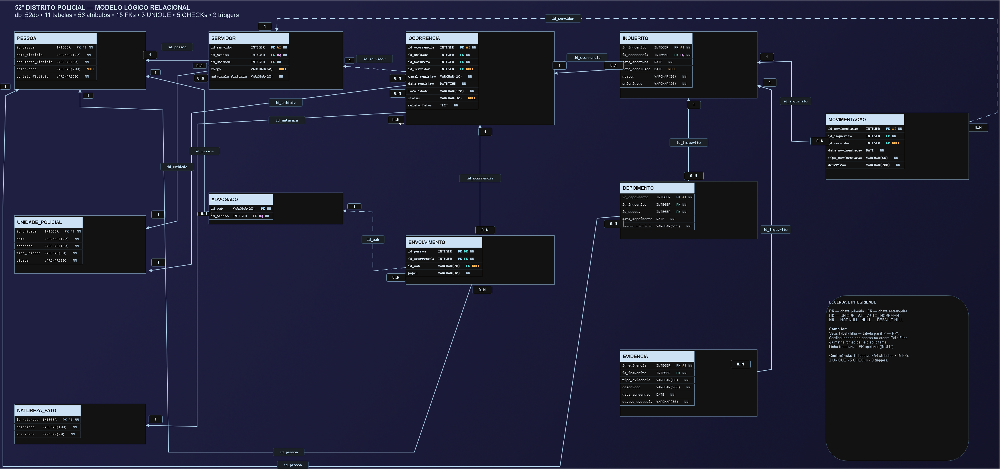

# Modelagem de Banco de Dados para o 52º Distrito Policial de São Paulo

**Relatório Técnico Final — Entrega 2**  
Modelo lógico, implementação SQL e documentação.

## Integrantes do grupo

| Nome completo | RGM | GitHub |
|---|---:|---|
| Enzo Freire dos Santos | 47806303 | [enzofreire-cmd](https://github.com/enzofreire-cmd) |
| Eduardo Vinicius Ribeiro Costa | 48693855 | [EduardoRibeiro-007](https://github.com/EduardoRibeiro-007) |
| Giovanna Ribeiro Souza | 47952822 | [gioribeirro](https://github.com/gioribeirro) |
| João Victor da Costa Silva | 49227238 | [Thevic69](https://github.com/Thevic69) |
| Paulo Henrique Camilo de Pascoa Souza | 47806745 | [phpascoa](https://github.com/phpascoa) |

---

## 1. Introdução e caracterização da organização

### 1.1 Introdução

Este trabalho apresenta a modelagem de um banco de dados para o 52º Distrito Policial de São Paulo, com o objetivo de organizar e representar os processos envolvidos no registro e acompanhamento de ocorrências e inquéritos policiais.

A proposta considera as etapas documentadas pelo grupo: registro inicial da ocorrência, análise e eventual conversão em inquérito, instrução, registro de depoimentos, controle de evidências, movimentações e conclusão.

Para compreender o funcionamento da unidade, o grupo realizou entrevistas de campo com uma agente policial que possui 35 anos de atuação na área e complementou o levantamento com informações fornecidas por um servidor responsável pelo registro de ocorrências. Durante a pesquisa, foi identificada a dependência do DESP, sistema estadual utilizado em São Paulo, que apresenta quedas frequentes e prejudica o registro e o acompanhamento dos procedimentos.

### 1.2 Identificação e contexto

| Item | Descrição |
|---|---|
| Organização | 52º Distrito Policial de São Paulo (Polícia Civil do Estado de São Paulo) |
| Natureza | Instituição pública, sem fins lucrativos |
| Endereço | R. Dr. Coryntho Baldoíno Costa, 400 – Vila Zilda, São Paulo – SP, 03069-070 ([localização no Google Maps](https://maps.app.goo.gl/KpnnQxBFQmJx874c8)) |
| Contato institucional | (11) 2293-6036 |
| Atividade | Registro de ocorrências e condução de inquéritos policiais, incluindo instrução, depoimentos, evidências, movimentações e conclusão |
| Canais de registro | Presencial e online, conforme relato da entrevista |

Trata-se de uma instituição pública responsável pelo atendimento e registro de ocorrências e pela condução de procedimentos de investigação policial. Segundo as informações levantadas, a unidade conta com um delegado titular, um investigador/agente responsável pelo registro de ocorrências e seis escrivães dedicados aos procedimentos de inquérito.

O volume de trabalho foi descrito como elevado e crescente. Foi relatado que cada delegado responde, em média, por 200 a 300 inquéritos por mês, “dependendo do lugar”. Esse valor é mantido como relato da entrevista e não foi convertido em quantidade de inquéritos abertos ou concluídos. A quantidade de ocorrências não apresenta previsibilidade mensal, pois há crescimento ao longo dos anos e os registros acontecem presencialmente e online.

### 1.3 Problemas e necessidades identificados

A unidade utiliza o DESP, sistema estadual que abrange todo o estado de São Paulo e apresenta instabilidades frequentes. Também foi identificada a necessidade de melhorar a organização e a rastreabilidade dos casos, desde o registro da ocorrência até a eventual abertura, instrução e conclusão do inquérito.

A concentração das informações em um sistema instável dificulta o acompanhamento dos procedimentos e a obtenção de indicadores sobre volume de ocorrências por canal, natureza e situação. O projeto propõe, portanto, um modelo relacional capaz de organizar essas informações, representar os relacionamentos entre as pessoas envolvidas e permitir consultas gerenciais e verificações de integridade. O banco proposto não substitui nem corrige a instabilidade do DESP.

### 1.4 Justificativa da escolha da organização

O 52º Distrito Policial foi escolhido por ser uma instituição pública com processos definidos — registro de ocorrência, possível abertura de inquérito, instrução e conclusão — e por apresentar volume e variedade de informações suficientes para sustentar um modelo relacional com múltiplas entidades. Também houve possibilidade de acesso presencial a servidores para a realização da pesquisa de campo. Os registros do grupo não declaram vínculo de integrantes com a unidade.

### 1.5 Evidências da pesquisa de campo

**Registros da pesquisa:**

- [Áudio da entrevista](PrimeiraParteDoTrabalho/Audio%20da%20entrevista%201.mp4)
- [Registro fotográfico 1](PrimeiraParteDoTrabalho/Registro%201.jpeg)
- [Registro fotográfico 2](PrimeiraParteDoTrabalho/Registro%202.jpeg)
- [Registro fotográfico 3](PrimeiraParteDoTrabalho/Registro%203.jpeg)

  
   Registro 1 — fachada do 52º Distrito Policial, com a placa e o brasão da Polícia Civil.

  
   Registro 2 — integrantes do grupo na calçada, em frente ao banner da delegacia.

  
   Registro 3 — mesma cena do Registro 2, em outro enquadramento.

**Convenções de origem usadas neste documento:** *relatado* = dito na entrevista; *documentado* = registrado pelo grupo nos artefatos; *modelado* = decisão de modelagem; *implementado* = presente no script `db_52dp.sql`; *fictício* = dado da massa de testes, sem valor estatístico sobre a unidade.

---

## 2. Pesquisa de campo e processos de negócio

### 2.1 Registro da pesquisa

| Item | Registro |
|---|---|
| Entrevistada principal | Agente da unidade, com 35 anos de atuação na área policial. Não autorizou a divulgação do nome nem forneceu contato pessoal; por isso, a identificação foi omitida. |
| Complemento | Servidor que atua no registro de ocorrências. A resposta C14 informa que as ocorrências “são feitas pelo entrevistado e mais um colega”. O nome não consta dos registros do grupo. |
| Integrante responsável pela entrevista | Giovanna Ribeiro Souza elaborou as perguntas, conduziu a maior parte da entrevista e anotou as respostas. Três integrantes aparecem nas fotografias, mas os registros não identificam quais. |
| 1ª visita | 04/09/2026, às 17h10, no 52º DP: entrevista principal (P1 a P10 e observações adicionais). |
| 2ª visita | 24/09/2026, às 16h09, no 52º DP: complemento das informações (C10, C11, C13 e C14). O áudio foi gravado por volta das 17h22 e tem 2 min 36 s. |
| Responsável pela organização | O nome não está documentado nem autorizado para divulgação. Contato institucional: (11) 2293-6036. |

O levantamento completo está em [levantamento.md](levantamento.md). O áudio é evidência complementar; o texto de referência da pesquisa de campo é o levantamento escrito.

### 2.2 Limites da observação presencial

O grupo observou apenas a recepção. A entrevista ocorreu em local aberto, em frente à delegacia, próximo ao estacionamento. Não havia grande movimentação naquele horário, e escrivães e outros profissionais não estavam na recepção. As fotografias mostram porta de vidro com balcão ao fundo, rampa com piso tátil e sinalização de acessibilidade, bancos de concreto e o banner da delegacia.

Nenhum dos processos descritos neste relatório foi observado em execução: as informações sobre os processos decorrem das respostas da entrevista. A entrevistada também não forneceu dados sobre equipamentos ou sistemas além do DESP.

### 2.3 Processos identificados

A partir das respostas da pesquisa de campo, foram identificados seis processos principais:

1. **Registro de ocorrência.** Qualquer servidor autorizado pode registrar uma ocorrência; a atividade não é exclusiva dos escrivães. O registro reúne relatos e acontecimentos de forma imparcial, presencialmente ou online. As pessoas são vinculadas à ocorrência conforme seus papéis, como vítima, testemunha, acusado e comunicante.
2. **Análise e conversão em inquérito.** O delegado titular analisa o boletim de ocorrência. A conversão em inquérito acontece quando existem indícios ou provas materializadas dos fatos. Sem essa comprovação, a ocorrência permanece em investigação; o levantamento também registra a possibilidade de cancelamento quando a materialidade não é comprovada.
3. **Instrução do inquérito.** Envolve coleta de depoimentos e evidências. A vítima pode prestar depoimento diretamente. As atividades são conduzidas por escrivão e delegado, em procedimentos físicos e digitais.
4. **Movimentação processual.** Corresponde à distribuição e às demais alterações realizadas durante a tramitação do inquérito. Na unidade pesquisada, essas atividades são realizadas pelos escrivães ou pelo delegado; os escrivães atuam exclusivamente em procedimentos de inquérito.
5. **Acompanhamento do caso.** A vítima pode acompanhar diretamente o andamento. O acusado realiza esse acompanhamento por intermédio de advogado, respeitadas as condições legais de acesso aos autos.
6. **Conclusão do inquérito.** O procedimento é encerrado com o registro de sua situação e da respectiva data de conclusão.

### 2.4 Achados da entrevista

- O inquérito serve para apurar os fatos, ouvir os dois lados e verificar a veracidade das informações (P1).
- A ocorrência é registrada com imparcialidade, anotando-se relatos e fatos, principalmente os ocorridos no momento da situação (P2 e P3).
- Qualquer pessoa autorizada dentro da delegacia pode registrar; quem comunica pode ser a vítima ou qualquer pessoa que conheça os fatos (P4).
- Os registros são frequentes, principalmente os relacionados a estelionato, com padrões mencionados como golpe do amor e falsa delegacia (P5).
- Só há conversão em inquérito com prova materializada; sem ela, o caso permanece em investigação (C11). O delegado titular analisa o boletim e instaura o inquérito ao identificar indícios de crime (P7 e P10). Se a materialidade não for comprovada, o procedimento pode ser cancelado (P2).
- Depoimentos e evidências são registrados no inquérito físico e no digital; escrivão e delegado são responsáveis (P8).
- A vítima pode acompanhar o andamento; o acusado, somente por meio de advogado (P9).
- O DESP abrange todo o estado e apresenta quedas frequentes.
- A agente expressou a opinião de que algumas ocorrências não deveriam ir à delegacia e de que seria útil um espaço de apoio para relatos de menor gravidade. Essa opinião foi registrada, mas não gerou requisito nem alteração no modelo.

### 2.5 Porte, volume e limites do levantamento

- **Escrivães:** seis, dedicados exclusivamente aos inquéritos.
- **Registro de ocorrências:** segundo o complemento C14, feito pelo entrevistado e por mais um colega; os escrivães não registram ocorrências.
- **Análise dos boletins:** realizada pelo delegado titular, que instaura o inquérito quando identifica os elementos necessários.
- **Carga relatada:** 200 a 300 inquéritos por mês para cada delegado, “dependendo do lugar”. O valor é preservado como foi relatado.
- **Ocorrências:** número crescente ao longo dos anos e sem previsibilidade mensal, com registro físico e online.

O levantamento não traz uma série mensal de boletins de ocorrência nem o quantitativo total real de servidores. Por isso, esses números não foram inventados. A massa de testes utiliza dez servidores fictícios (seis escrivães, dois delegados e dois investigadores/agentes), apenas para exercitar consultas; essa composição não descreve a lotação real.

### 2.6 Problemas e contribuição prevista do modelo

| Código | Problema identificado | Origem | Contribuição do modelo |
|---|---|---|---|
| P1 | O DESP cai com frequência e dificulta registro e acompanhamento. | Relatado no levantamento | Base relacional própria e consultável sem depender do DESP; não substitui nem corrige o sistema estadual. |
| P2 | Os casos precisam ser acompanhados do registro à abertura, instrução e conclusão do inquérito. | Relatado (P1, P6, P8, P9, C11) | Separa OCORRENCIA de INQUERITO e registra situações, datas e movimentações. |
| P3 | O volume de ocorrências cresce e não é previsível por mês; existem dois canais de entrada. | Relatado (C10) | `canal_registro` e `data_registro` permitem medir tendência e participação por canal. |
| P4 | Há padrões de natureza recorrentes, como estelionato, golpe do amor e falsa delegacia. | Relatado (P5, P10) | `NATUREZA_FATO` classifica ocorrências e `localidade` permite recortes territoriais. |
| P5 | A carga de trabalho é alta e a distribuição entre servidores não é visível. | Relatado (C13, C14) | MOVIMENTACAO associa cada ato do inquérito ao servidor responsável. |
| P6 | Instrução e acompanhamento por vítima e advogado do acusado precisam de controle estruturado. | Relatado (P8, P9) | DEPOIMENTO, EVIDENCIA e ENVOLVIMENTO (com `id_oab`) estruturam os registros. |

---

## 3. Requisitos do sistema

### 3.1 Escopo

O banco cobre o ciclo documentado: cadastro da unidade, servidores e pessoas; registro de ocorrências com natureza e envolvidos; abertura de inquérito; depoimentos, evidências, movimentações e conclusão. Não cobre autenticação, controle de acesso em tempo de execução, interface de usuário nem integração com o DESP.

**Processos típicos não incluídos:** o levantamento não registra outros processos, como gestão de custódia física de bens, escala de equipe ou comunicação com outros órgãos. Eles não foram modelados por não terem sido levantados; isso não significa que a unidade não os execute.

### 3.2 Requisitos funcionais (RF)

| Código | Requisito | Estruturas relacionadas |
|---|---|---|
| RF01 | Permitir o registro de ocorrência, identificando unidade policial, servidor responsável, natureza do fato, canal, data e hora, localidade, situação e relato. | OCORRENCIA |
| RF02 | Permitir vincular uma ou mais pessoas a uma ocorrência, identificando o papel de cada uma. | PESSOA, ENVOLVIMENTO |
| RF03 | Permitir abrir inquérito a partir de ocorrência somente quando houver prova materializada dos fatos. | INQUERITO |
| RF04 | Permitir registrar depoimentos vinculados a um inquérito e à pessoa que depôs. | DEPOIMENTO |
| RF05 | Permitir registrar evidências vinculadas a um inquérito, incluindo tipo, descrição, data de apreensão e situação da cadeia de custódia. | EVIDENCIA |
| RF06 | Permitir registrar movimentações de inquérito, identificando o servidor responsável. | MOVIMENTACAO |
| RF07 | Permitir consultar a situação de uma ocorrência ou de um inquérito. | OCORRENCIA, INQUERITO |
| RF08 | Permitir gerar relatórios gerenciais, como ocorrências por natureza e canal e inquéritos por situação. | Consultas G01 a G19 e views `vw_bi_*` |
| RF09 | Permitir atualizar a situação e a data de conclusão de um inquérito. | INQUERITO |
| RF10 | Permitir registrar a representação de uma pessoa acusada por advogado, vinculando o profissional à ocorrência correspondente. | ENVOLVIMENTO, ADVOGADO |

RF01 a RF06 e RF10 correspondem a estruturas de armazenamento implementadas no script. RF07 e RF08 correspondem às consultas G01 a G19 e às views. RF09 é uma operação sobre colunas existentes; o script `db_52dp.sql` não contém um comando `UPDATE` que a exercite.

### 3.3 Requisitos não funcionais (RNF)

| Código | Requisito | Situação no projeto |
|---|---|---|
| RNF01 | Disponibilidade contínua, reduzindo a dependência da instabilidade do DESP. | Requisito de projeto; depende de infraestrutura e hospedagem, não implementadas pelo script. |
| RNF02 | Integridade dos registros, sem alterações retroativas sem rastreabilidade. | Integridade referencial e `CHECK` implementados; trilha de auditoria de alterações não implementada. |
| RNF03 | Segurança e privacidade, com acesso restrito e auditável aos dados. | Requisito de projeto. A matriz de acesso é proposta; o script não cria perfis nem permissões. |
| RNF04 | Rastreabilidade: toda movimentação registra data e responsável. | Implementado com `data_movimentacao` (`DATE`, sem hora) e `id_servidor`. |
| RNF05 | Usabilidade: registro simples para qualquer servidor autorizado. | Requisito de interface; não há interface implementada. |
| RNF06 | Escalabilidade para crescimento anual do volume. | Modelo normalizado em InnoDB, com chaves e views de BI; não houve teste de carga. |

---

## 4. Regras de negócio e restrições

### 4.1 Regras operacionais

| Código | Regra | Como aparece no banco |
|---|---|---|
| RN01 | Uma ocorrência somente pode ser convertida em inquérito quando houver prova materializada; caso contrário, permanece em investigação. | Domínio de `OCORRENCIA.status` e `UNIQUE(INQUERITO.id_ocorrencia)`. A existência de prova não é imposta diretamente pelo banco; é conferida por V01, V02 e V05. |
| RN02 | Qualquer servidor autorizado pode registrar ocorrência; não é atividade exclusiva dos escrivães. | `OCORRENCIA.id_servidor` referencia SERVIDOR. Não há restrição de cargo no banco para o registro. |
| RN03 | Escrivães atuam exclusivamente nos procedimentos de inquérito, incluindo depoimentos, evidências e movimentações. | Conferido por V03 e V04; a regra de cargo para movimentações é imposta por trigger (RN09). |
| RN04 | A vítima acompanha diretamente o andamento; o acusado, por meio de advogado, respeitadas as condições legais. | Modelado por ENVOLVIMENTO (`papel`, `id_oab`). A concessão de acesso depende da aplicação. |
| RN05 | A data de conclusão deve ser igual ou posterior à data de abertura. | `CHECK chk_datas_inquerito`. |
| RN06 | Toda ocorrência deve possuir relato dos fatos. | `relato_fatos TEXT NOT NULL`. |
| RN07 | O canal de registro é obrigatório e pode ser Presencial ou Online. | `canal_registro NOT NULL` e `CHECK chk_ocorrencia_canal`. |
| RN08 | A pessoa acusada pode ter advogado associado; a representação é registrada separadamente do papel da pessoa. | `ENVOLVIMENTO.id_oab` é FK opcional; `CHECK` impede o papel “Advogado”. V07 verifica que só acusados tenham advogado vinculado. |
| RN09 | Movimentações devem ser realizadas por servidores autorizados, respeitando as funções de escrivão e delegado. | Triggers `trg_movimentacao_cargo_bi`, `trg_movimentacao_cargo_bu` e `trg_servidor_cargo_bu`. |

### 4.2 Restrições organizacionais e legais

- A unidade utiliza roteiro institucional padronizado nas entrevistas. O complemento referente às perguntas 10, 11, 13 e 14 foi registrado separadamente para evitar conflito com a numeração da entrevista original.
- A quantidade de seis escrivães e sua atuação exclusiva em procedimentos de inquérito foram consideradas características organizacionais do modelo.
- Todos os dados pessoais usados como exemplos no projeto são fictícios.
- A numeração RN01 a RN09 é a adotada nesta versão. Na Entrega 1, a regra de relato e a de canal apareciam juntas; nesta versão foram separadas em RN06 e RN07. A numeração R1 a R14 do Dicionário de Dados é independente e deve ser citada como “R” quando necessário.
- Foram consideradas a Súmula Vinculante 14 do STF e o art. 7º, XIV e §§ 10 e 11, da Lei nº 8.906/1994, relativos ao acesso do advogado aos elementos documentados e às condições de acesso a autos sigilosos ou diligências em andamento. O art. 4º, III, da Lei nº 13.709/2018 (LGPD) também foi considerado: a exclusão do âmbito geral para tratamento com fins de investigação e repressão penal não autoriza uso irrestrito de dados pessoais.
- O campo `id_oab` não comprova procuração nem regularidade da inscrição do advogado.
- Prazos legais de inquérito, retenção de dados e política de anonimização não foram levantados com a unidade e não estão no modelo.

**Fontes legais consultadas:** [Lei nº 8.906/1994 — Estatuto da Advocacia](https://www2.camara.leg.br/legin/fed/lei/1994/lei-8906-4-julho-1994-349751-normaatualizada-pl.html) e [Súmula Vinculante 14 — STF](https://portal.stf.jus.br/jurisprudencia/sumariosumulas.asp?base=26%20&sumula=1230).

---

## 5. Dicionário de dados conceitual

O modelo final considera **11 entidades e 56 atributos**, com PESSOA como superentidade e SERVIDOR e ADVOGADO como especializações. A seguir estão reunidos os atributos e as regras essenciais documentados para cada entidade. Para tipos SQL, obrigatoriedade e restrições definitivas, consultar também o [Dicionário de Dados em HTML](Dicionario_de_Dados_52_DP.html) e o [Modelo Lógico documentado](Modelo_Logico_Documentacao.html).

### 5.1 UNIDADE_POLICIAL

Representa a unidade policial e permite vincular servidores e ocorrências.

| Atributo | Descrição | Regra |
|---|---|---|
| `id_unidade` | Identificador único da unidade | Chave primária |
| `nome` | Nome oficial da unidade | Obrigatório |
| `endereco` | Endereço físico completo | Obrigatório |
| `tipo_unidade` | Classificação da unidade | Obrigatório |
| `cidade` | Cidade e UF | Obrigatório |

### 5.2 PESSOA

Superentidade que representa todas as pessoas envolvidas no sistema, evitando repetição de informações comuns em envolvidos, servidores e advogados.

| Atributo | Descrição | Regra |
|---|---|---|
| `id_pessoa` | Identificador único da pessoa | Chave primária |
| `nome_ficticio` | Nome fictício | Obrigatório |
| `documento_ficticio` | Documento fictício | Obrigatório |
| `observacao` | Informações adicionais | Opcional |
| `contato_ficticio` | Contato fictício | Obrigatório |

### 5.3 SERVIDOR

Especialização de PESSOA destinada aos profissionais da unidade policial.

| Atributo | Descrição | Regra |
|---|---|---|
| `id_servidor` | Identificador do servidor | Chave primária |
| `id_pessoa` | Pessoa correspondente | FK para PESSOA e UNIQUE |
| `id_unidade` | Unidade à qual pertence | FK para UNIDADE_POLICIAL |
| `cargo` | Função exercida | Delegado, Escrivão ou Investigador/Agente |
| `matricula_ficticia` | Matrícula funcional fictícia | Obrigatório |

### 5.4 ADVOGADO

Especialização de PESSOA destinada à identificação dos advogados que representam pessoas envolvidas nos procedimentos. ADVOGADO não é um cargo de SERVIDOR.

| Atributo | Descrição | Regra |
|---|---|---|
| `id_oab` | Identificação de inscrição na OAB | Chave primária (`VARCHAR(20)` no script) |
| `id_pessoa` | Pessoa correspondente | FK para PESSOA e UNIQUE |

### 5.5 NATUREZA_FATO

Classifica a natureza das ocorrências. O estelionato foi destacado na entrevista como uma das naturezas mais frequentes, incluindo golpe do amor e falsa delegacia.

| Atributo | Descrição | Regra |
|---|---|---|
| `id_natureza` | Identificador da natureza do fato | Chave primária |
| `descricao` | Descrição da natureza, como furto e estelionato | Obrigatório |
| `gravidade` | Nível de gravidade | Obrigatório |

### 5.6 OCORRENCIA

Representa o registro inicial do fato, incluindo canal, localidade, situação e relato imparcial.

| Atributo | Descrição | Regra |
|---|---|---|
| `id_ocorrencia` | Identificador único da ocorrência | Chave primária |
| `id_unidade` | Unidade onde foi registrada | FK para UNIDADE_POLICIAL |
| `id_natureza` | Natureza do fato | FK para NATUREZA_FATO |
| `id_servidor` | Servidor responsável pelo registro | FK para SERVIDOR; opcional no script |
| `canal_registro` | Canal utilizado | Presencial ou Online; obrigatório |
| `data_registro` | Data e hora do registro | Obrigatório (`DATETIME`) |
| `localidade` | Local onde ocorreu o fato | Obrigatório |
| `status` | Situação da ocorrência | Em análise, Em investigação, Convertida em inquérito ou Cancelada |
| `relato_fatos` | Descrição imparcial dos acontecimentos | Obrigatório (`TEXT`) |

O nome final da FK no script é `id_servidor`; uma versão anterior do dicionário usava `id_servidor_registro`.

### 5.7 ENVOLVIMENTO

Entidade associativa responsável por relacionar pessoas às ocorrências e registrar o papel de cada pessoa, incluindo a associação com advogado quando aplicável.

| Atributo | Descrição | Regra |
|---|---|---|
| `id_pessoa` | Pessoa envolvida | Parte da PK composta e FK para PESSOA |
| `id_ocorrencia` | Ocorrência correspondente | Parte da PK composta e FK para OCORRENCIA |
| `papel` | Papel desempenhado na ocorrência | Vítima, Testemunha, Acusado ou Comunicante |
| `id_oab` | Advogado associado à representação | FK opcional para ADVOGADO |

A chave primária composta é (`id_pessoa`, `id_ocorrencia`). O par identifica a participação de uma pessoa em uma ocorrência. O campo `id_oab` permite identificar o advogado relacionado à pessoa representada. A mesma pessoa pode assumir papéis diferentes em ocorrências distintas.

### 5.8 INQUERITO

Representa o procedimento formal originado de uma ocorrência. A FK `id_ocorrencia` é UNIQUE, estabelecendo a relação de uma ocorrência para zero ou um inquérito.

| Atributo | Descrição | Regra |
|---|---|---|
| `id_inquerito` | Identificador único do inquérito | Chave primária |
| `id_ocorrencia` | Ocorrência que originou o inquérito | FK para OCORRENCIA e UNIQUE |
| `data_abertura` | Data de abertura | Obrigatório |
| `data_conclusao` | Data de conclusão | Opcional enquanto estiver em andamento |
| `status` | Situação do inquérito | Obrigatório |
| `prioridade` | Nível de prioridade | Obrigatório |

### 5.9 DEPOIMENTO

Armazena depoimentos relacionados ao inquérito. DEPOIMENTO possui chave primária simples e não é entidade associativa.

| Atributo | Descrição | Regra |
|---|---|---|
| `id_depoimento` | Identificador único do depoimento | Chave primária |
| `id_inquerito` | Inquérito relacionado | FK para INQUERITO |
| `id_pessoa` | Pessoa que prestou o depoimento | FK para PESSOA |
| `data_depoimento` | Data do depoimento | Obrigatório |
| `resumo_ficticio` | Resumo fictício do conteúdo | Obrigatório |

### 5.10 EVIDENCIA

Representa elementos de prova relacionados ao inquérito.

| Atributo | Descrição | Regra |
|---|---|---|
| `id_evidencia` | Identificador único da evidência | Chave primária |
| `id_inquerito` | Inquérito relacionado | FK para INQUERITO |
| `tipo_evidencia` | Tipo da evidência | Documento, objeto etc. |
| `descricao` | Descrição da evidência | Obrigatório |
| `data_apreensao` | Data da apreensão | Obrigatório |
| `status_custodia` | Situação da cadeia de custódia | Obrigatório |

### 5.11 MOVIMENTACAO

Registra o histórico de tramitação do inquérito.

| Atributo | Descrição | Regra |
|---|---|---|
| `id_movimentacao` | Identificador da movimentação | Chave primária |
| `id_inquerito` | Inquérito relacionado | FK para INQUERITO |
| `id_servidor` | Servidor responsável | FK para SERVIDOR; opcional no script |
| `data_movimentacao` | Data da movimentação | Obrigatório (`DATE`, sem hora) |
| `tipo_movimentacao` | Tipo de movimentação | Obrigatório |
| `descricao` | Descrição da movimentação | Obrigatório |

---

## 6. Modelagem conceitual e relacionamentos

### 6.1 Entidades reconhecidas

O modelo conceitual foi desenvolvido considerando as 11 entidades descritas no dicionário: UNIDADE_POLICIAL, PESSOA, SERVIDOR, ADVOGADO, NATUREZA_FATO, OCORRENCIA, ENVOLVIMENTO, INQUERITO, DEPOIMENTO, EVIDENCIA e MOVIMENTACAO.

### 6.2 Relacionamentos e cardinalidades

- UNIDADE_POLICIAL (1) — (N) SERVIDOR.
- UNIDADE_POLICIAL (1) — (N) OCORRENCIA.
- NATUREZA_FATO (1) — (N) OCORRENCIA.
- SERVIDOR (1) — (N) OCORRENCIA, como responsável pelo registro.
- PESSOA (1) — (N) ENVOLVIMENTO.
- OCORRENCIA (1) — (N) ENVOLVIMENTO.
- PESSOA — OCORRENCIA, por ENVOLVIMENTO: relacionamento N:M.
- OCORRENCIA (1) — (0,1) INQUERITO.
- PESSOA (1) — (0,1) SERVIDOR, considerando a especialização.
- PESSOA (1) — (0,1) ADVOGADO, considerando a especialização.
- INQUERITO (1) — (N) DEPOIMENTO.
- PESSOA (1) — (N) DEPOIMENTO.
- INQUERITO (1) — (N) EVIDENCIA.
- INQUERITO (1) — (N) MOVIMENTACAO.
- SERVIDOR (1) — (N) MOVIMENTACAO.
- ADVOGADO (1) — (N) ENVOLVIMENTO, conforme a associação de representação.

### 6.3 Restrições conceituais aplicadas

- Uma ocorrência somente pode originar um inquérito quando houver prova materializada dos fatos.
- SERVIDOR e ADVOGADO são especializações de PESSOA, evitando duplicação de informações comuns.
- O papel de vítima, testemunha, acusado ou comunicante é registrado em ENVOLVIMENTO, e não como entidade independente.
- `canal_registro` representa a coexistência dos canais presencial e online.
- As movimentações devem respeitar as funções autorizadas de escrivães e delegado.
- A associação de advogado deve representar a pessoa e a ocorrência correspondentes.

### 6.4 Revisões realizadas entre as versões conceituais

A correção original da Entrega 1 não consta dos materiais do grupo. As alterações abaixo são as que estão documentadas no Dicionário de Dados, no levantamento e nos registros do grupo:

| Alteração | O que mudou | Motivo registrado |
|---|---|---|
| Remoção de VITIMA | A vítima passou a ser um valor de `papel` em ENVOLVIMENTO. | Vítima é papel da pessoa na ocorrência, não um tipo de entidade. |
| PESSOA como superentidade | Nome, documento, observação e contato ficam em PESSOA. | Evitar repetição de dados comuns. |
| SERVIDOR como especialização | `SERVIDOR.id_pessoa` é FK UNIQUE; o nome fictício foi removido de SERVIDOR. | Um servidor também é uma pessoa. |
| ADVOGADO como especialização | Nova entidade com `id_oab` e `id_pessoa` UNIQUE; não é cargo de SERVIDOR. | Resposta P9 sobre acompanhamento por advogado. |
| ENVOLVIMENTO como associativa | PK composta (`id_pessoa`, `id_ocorrencia`), `papel` e `id_oab` opcional. | A mesma pessoa pode ter papéis diferentes em ocorrências diferentes. |
| Retirada do campo “Id pessoa” antigo | Campo retirado da estrutura anterior. | Considerado inadequado após orientação do professor, conforme registro do grupo. |
| OCORRENCIA e INQUERITO separados | `INQUERITO.id_ocorrencia` recebeu UNIQUE. | Nem toda ocorrência vira inquérito (C11). |
| Inclusão de `canal_registro` e `relato_fatos` | Canal Presencial/Online e relato obrigatório em TEXT. | Respostas P3 e C10. |
| Inclusão de `Cancelada` | Valor incluído no domínio de `OCORRENCIA.status`. | Resposta P2. |
| Padronização de `id_servidor` | Substituiu `id_servidor_registro`. | Padronizar o nome da FK de SERVIDOR. |
| Correção de DEPOIMENTO | PK simples `id_depoimento`; deixou de ser tratada como associativa. | Tem atributos próprios e duas FKs; a associativa é ENVOLVIMENTO. |
| Cardinalidades e UNIQUE | Cardinalidades inferidas a partir das FKs e regras. | A fonte original não declarava cardinalidades. |

A especialização PESSOA → SERVIDOR/ADVOGADO é parcial e sobreposta: uma pessoa pode ser servidor, advogado, ambos ou nenhum.

---

## 7. Diagrama Entidade-Relacionamento (DER)

O DER representa graficamente as entidades, os atributos, as especializações e os relacionamentos identificados durante a modelagem conceitual.

  

**Observação sobre a versão arquivada:** a imagem [DER Modelo Conceitual.png](DER%20Modelo%20Conceitual.png) mostra uma versão anterior do conceitual, ainda com a entidade `Especialização` e os relacionamentos `Defesa` e `Defende`, sem a generalização de PESSOA. A estrutura vigente é a descrita nas tabelas deste documento e no [Dicionário de Dados](Dicionario_de_Dados_52_DP.html).

---

## 8. Modelo lógico relacional e normalização

### 8.1 Conversão do modelo conceitual para o lógico

A conversão está documentada em [Modelo_Logico_Documentacao.html](Modelo_Logico_Documentacao.html) e implementada em [db_52dp.sql](db_52dp.sql).

- **Entidades → tabelas:** cada uma das 11 entidades virou uma tabela com o mesmo nome, em maiúsculas.
- **Atributos → colunas:** textos curtos usam `VARCHAR`; `relato_fatos` usa `TEXT`; `data_registro` usa `DATETIME`; as demais datas usam `DATE`. Identificadores usam `INTEGER AUTO_INCREMENT`, exceto `ADVOGADO.id_oab`, que usa `VARCHAR(20)`.
- **Obrigatoriedade:** atributos obrigatórios são representados por `NOT NULL`; atributos opcionais podem usar `DEFAULT NULL`.
- **Relacionamentos 1:N e 1:0..1:** implementados por FKs no lado “muitos”. No relacionamento OCORRENCIA–INQUERITO, `INQUERITO.id_ocorrencia` recebe `UNIQUE`.
- **Relacionamento N:M:** PESSOA ↔ OCORRENCIA foi convertido em ENVOLVIMENTO, com PK composta (`id_pessoa`, `id_ocorrencia`).
- **Entidade associativa:** ENVOLVIMENTO contém `papel` e `id_oab`; este último é FK opcional para ADVOGADO.
- **Especialização:** foi adotada a estratégia de uma tabela por entidade (PESSOA, SERVIDOR e ADVOGADO). Cada especialização possui FK para PESSOA com UNIQUE, implementando a cardinalidade 1:0..1. A estratégia atende à especialização sobreposta e mantém os atributos próprios (`cargo`, `matricula_ficticia` e `id_oab`) sem misturar colunas de naturezas distintas.
- **Identificação:** SERVIDOR possui PK própria `id_servidor`, referenciada por OCORRENCIA e MOVIMENTACAO; ADVOGADO usa `id_oab` como PK, referenciada por ENVOLVIMENTO.

Nulabilidades não declaradas na fonte — `OCORRENCIA.id_servidor`, `OCORRENCIA.status`, `SERVIDOR.cargo` e `MOVIMENTACAO.id_servidor` — foram implementadas como opcionais (`DEFAULT NULL`) no script.

### 8.2 Chaves primárias e estrangeiras

| Tabela | Chave primária | Chaves estrangeiras | Outras restrições |
|---|---|---|---|
| UNIDADE_POLICIAL | `id_unidade` | — | — |
| PESSOA | `id_pessoa` | — | — |
| NATUREZA_FATO | `id_natureza` | — | — |
| SERVIDOR | `id_servidor` | `id_pessoa` → PESSOA; `id_unidade` → UNIDADE_POLICIAL | `UNIQUE(id_pessoa)` |
| ADVOGADO | `id_oab` | `id_pessoa` → PESSOA | `UNIQUE(id_pessoa)` |
| OCORRENCIA | `id_ocorrencia` | `id_unidade` → UNIDADE_POLICIAL; `id_natureza` → NATUREZA_FATO; `id_servidor` → SERVIDOR (opcional) | — |
| ENVOLVIMENTO | (`id_pessoa`, `id_ocorrencia`) | `id_pessoa` → PESSOA; `id_ocorrencia` → OCORRENCIA; `id_oab` → ADVOGADO (opcional) | PK composta |
| INQUERITO | `id_inquerito` | `id_ocorrencia` → OCORRENCIA | `UNIQUE(id_ocorrencia)` |
| DEPOIMENTO | `id_depoimento` | `id_inquerito` → INQUERITO; `id_pessoa` → PESSOA | — |
| EVIDENCIA | `id_evidencia` | `id_inquerito` → INQUERITO | — |
| MOVIMENTACAO | `id_movimentacao` | `id_inquerito` → INQUERITO; `id_servidor` → SERVIDOR (opcional) | — |

São dez tabelas com PK simples e uma com PK composta (ENVOLVIMENTO). A enumeração das FKs na tabela acima totaliza 15 referências: duas em SERVIDOR, uma em ADVOGADO, três em OCORRENCIA, três em ENVOLVIMENTO, uma em INQUERITO, duas em DEPOIMENTO, uma em EVIDENCIA e duas em MOVIMENTACAO.

### 8.3 Processo de normalização (1FN, 2FN e 3FN)

A verificação foi feita sobre as 11 tabelas, a partir das dependências funcionais inferidas do dicionário de dados. As dependências não foram confirmadas com a unidade; foram inferidas dos atributos e das regras documentadas.

**1FN — atributos atômicos e sem grupos repetitivos.**

- Todos os atributos são atômicos. `contato_ficticio` é tratado como um único dado de comunicação; `relato_fatos` é um único relato.
- Conjuntos repetitivos foram separados em tabelas próprias: várias pessoas por ocorrência (ENVOLVIMENTO), vários depoimentos, evidências e movimentações por inquérito (DEPOIMENTO, EVIDENCIA e MOVIMENTACAO).

**2FN — ausência de dependência parcial.**

Dez tabelas têm PK simples e atendem automaticamente à 2FN. ENVOLVIMENTO exige análise: (`id_pessoa`, `id_ocorrencia`) determina `papel` e `id_oab`. O papel é da pessoa naquela ocorrência e o advogado está vinculado àquele envolvimento; nenhum dos dois é determinado apenas por `id_pessoa` ou apenas por `id_ocorrencia`.

**3FN — ausência de dependência transitiva.**

| Tabela | Dependências funcionais principais | Observação |
|---|---|---|
| UNIDADE_POLICIAL | `id_unidade` → `nome`, `endereco`, `tipo_unidade`, `cidade` | Nenhum atributo descritivo determina outro. |
| PESSOA | `id_pessoa` → `nome_ficticio`, `documento_ficticio`, `observacao`, `contato_ficticio` | Dados comuns centralizados. |
| SERVIDOR | `id_servidor` → `id_pessoa`, `id_unidade`, `cargo`, `matricula_ficticia` | `id_pessoa` é chave candidata (UNIQUE). |
| ADVOGADO | `id_oab` → `id_pessoa` e `id_pessoa` → `id_oab` | Chaves candidatas entre si; sem outros atributos. |
| NATUREZA_FATO | `id_natureza` → `descricao`, `gravidade` | Gravidade fica na natureza, não repetida na ocorrência. |
| OCORRENCIA | `id_ocorrencia` → unidade, natureza, servidor, canal, data, localidade, status e relato | Unidade e natureza entram por FK. |
| ENVOLVIMENTO | (`id_pessoa`, `id_ocorrencia`) → `papel`, `id_oab` | Dados de PESSOA e ADVOGADO não são armazenados novamente. |
| INQUERITO | `id_inquerito` → ocorrência, datas, status e prioridade | `id_ocorrencia` é chave candidata (UNIQUE). |
| DEPOIMENTO | `id_depoimento` → inquérito, pessoa, data e resumo | Inquérito e pessoa entram por FK. |
| EVIDENCIA | `id_evidencia` → inquérito, tipo, descrição, data e custódia | Atributos dependem da evidência. |
| MOVIMENTACAO | `id_movimentacao` → inquérito, servidor, data, tipo e descrição | Descrição é texto livre, não derivado do tipo. |

**Resultado:** com as dependências declaradas ou inferidas, as 11 tabelas atendem à 1FN, 2FN e 3FN. `NATUREZA_FATO.descricao` não foi declarada única; caso seja definida como única, torna-se chave candidata e a 3FN se mantém.

**Redundâncias controladas:** o status `Convertida em inquérito` em OCORRENCIA e a existência de INQUERITO expressam o mesmo fato; a coerência é conferida por V01 e V02, não por restrição direta. O depoente de um inquérito deve estar envolvido na ocorrência de origem, o que V06 verifica. São regras entre tabelas.

### 8.4 Restrições implementadas e regras não impostas diretamente

| Restrição ou mecanismo | Regra relacionada | Comportamento documentado |
|---|---|---|
| `UNIQUE(SERVIDOR.id_pessoa)` e `UNIQUE(ADVOGADO.id_pessoa)` | Especialização 1:0..1 | Impedem duplicar a mesma pessoa na mesma especialização. |
| `UNIQUE(INQUERITO.id_ocorrencia)` | RN01 | Garante no máximo um inquérito por ocorrência. |
| `CHECK chk_servidor_cargo` | Dicionário R7 | Limita o cargo a Delegado, Escrivão ou Investigador/Agente; ADVOGADO não é cargo. |
| `CHECK chk_ocorrencia_canal` e `canal_registro NOT NULL` | RN07 | Restringem o canal a Presencial ou Online e exigem seu preenchimento. |
| `CHECK chk_ocorrencia_status` | Dicionário R4 | Restringe a situação da ocorrência a Em análise, Em investigação, Convertida em inquérito ou Cancelada. |
| `relato_fatos NOT NULL` | RN06 | Exige o relato dos fatos. |
| `CHECK chk_datas_inquerito` | RN05 | Permite data de conclusão nula ou igual/posterior à abertura. |
| `CHECK chk_envolvimento_papel` (`papel <> 'Advogado'`) | RN08 e Dicionário R8 | Mantém o advogado separado do papel da pessoa; o advogado é informado em `id_oab`. |
| Triggers `trg_movimentacao_cargo_bi`, `trg_movimentacao_cargo_bu` e `trg_servidor_cargo_bu` | RN09 | Bloqueiam responsável por movimentação que não seja Delegado ou Escrivão e impedem alterar o cargo de servidor que já possui movimentação. |
| `NOT NULL` nas demais colunas descritivas | Dicionário de dados | Implementa obrigatoriedade conforme a documentação de origem. |

**Regras que o banco não impõe diretamente:** a prova materializada para abrir inquérito (RN01), a restrição de escrivão registrar ocorrência (RN02/RN03), o acompanhamento por vítima e advogado (RN04) e a restrição de acesso (RNF03) dependem da aplicação ou são conferidas por consultas V. Os domínios de `INQUERITO.status`, `INQUERITO.prioridade`, `NATUREZA_FATO.gravidade` e `EVIDENCIA.status_custodia` não possuem `CHECK`, pois a fonte não os define.

### 8.5 Justificativas técnicas das decisões

**Separação entre ocorrência e inquérito.** OCORRENCIA e INQUERITO são entidades distintas porque nem toda ocorrência resulta na abertura de inquérito. A separação evita armazenar informações de inquérito em ocorrências que não avançaram para essa etapa.

**Organização de depoimentos, evidências e movimentações.** DEPOIMENTO, EVIDENCIA e MOVIMENTACAO foram relacionadas diretamente a INQUERITO, pois representam atividades realizadas durante a instrução e a tramitação do procedimento.

**Chaves primárias.** Identificadores inteiros com `AUTO_INCREMENT` são estáveis e curtos; dados descritivos podem mudar sem afetar referências. `ADVOGADO.id_oab` é `VARCHAR(20)` por representar a inscrição na OAB. ENVOLVIMENTO usa PK composta para impedir a duplicação da mesma pessoa na mesma ocorrência.

**Chaves estrangeiras.** Garantem que não haja inquérito sem ocorrência, depoimento sem inquérito nem movimentação com servidor inexistente. `ENVOLVIMENTO.id_oab` garante apenas que o advogado exista em ADVOGADO; não comprova procuração nem regularidade da inscrição.

**Limites jurídicos da modelagem.** O art. 3º do Estatuto da Advocacia estabelece a inscrição na OAB como requisito para o exercício da advocacia; o art. 7º, XIV e §§ 10 e 11, trata do acesso aos elementos documentados, de autos sigilosos e de diligências em andamento. A Súmula Vinculante 14 do STF também foi considerada. O registro de `id_oab` não comprova, por si só, procuração nem autorização de acesso; essas condições devem ser verificadas pela aplicação e pelos mecanismos de controle de acesso.

---

## 9. Proposta de arquitetura analítica para BI e IA

### 9.1 Informações estratégicas

- **Demanda:** volume, tendência, canal, natureza e localidade.
- **Fluxo:** triagem, conversão em inquérito, tempo até a abertura e situação dos inquéritos.
- **Capacidade:** distribuição de registros e movimentações entre servidores.
- **Instrução:** tipos de evidência e situação de custódia; papéis dos envolvidos e advogados vinculados.

### 9.2 Camadas

- **Implementado:** tabelas normalizadas; consultas gerenciais G01 a G19; verificações V01 a V11; quatro views para BI (`vw_bi_ocorrencias`, `vw_bi_inqueritos`, `vw_bi_kpis_mensais` e `vw_bi_demanda_agregada`).
- **Proposto, não implementado:** ETL incremental, modelo dimensional (fatos de ocorrência e inquérito; dimensões de calendário, natureza, localidade, canal, situação e unidade) e dashboards sobre as views. Os dados atuais são fictícios; não há dashboard publicado.

### 9.3 Indicadores (KPIs)

Todos os indicadores abaixo são calculáveis pelas consultas existentes. Não foram levantadas metas ou prazos normativos com a unidade; metas e SLA devem ser definidos pela gestão.

| KPI | Fórmula | Período | Consulta |
|---|---|---|---|
| Ocorrências registradas | Contagem de OCORRENCIA por mês, com variação sobre o mês anterior | Mensal | G02 |
| Participação online | Ocorrências online ÷ total | Mensal | G03, G01 |
| Taxa de conversão em inquérito | Ocorrências com inquérito ÷ total, por natureza | Total e por natureza | G01, G07 |
| Prazo médio até a abertura | Média de dias entre `data_registro` e `data_abertura` | Total | G08 |
| Duração média dos inquéritos concluídos | Média de dias entre `data_abertura` e `data_conclusao` | Por prioridade | G09 |
| Inquéritos em andamento por idade | Contagem por faixa de dias desde a abertura | Data atual | G10 |
| Concentração por natureza | Participação e percentual acumulado por natureza | Total | G04, G05 |
| Carga por servidor | Inquéritos instaurados, distribuídos e movimentações por servidor | Total | G11, G12, G13 |
| Evidências por custódia | Contagem por tipo e situação de custódia | Total | G15 |

### 9.4 Matriz de rastreabilidade

Códigos e conteúdos conferidos na documentação do script `db_52dp.sql`. As consultas de auditoria usam códigos V01 a V11; não há códigos Axx no script principal.

| Problema/KPI | Descrição | Tabelas | Consulta | Utilidade gerencial |
|---|---|---|---|---|
| P1 | Consultas executáveis sobre base própria, independentes do DESP (contribuição parcial). | OCORRENCIA, INQUERITO | G01 | Totais, conversão, participação online, inquéritos em andamento e duração média. |
| P2 | Funil de triagem das ocorrências. | OCORRENCIA | G06 | Situações em análise, em investigação, convertidas e canceladas. |
| P2 | Conversão em inquérito por natureza. | NATUREZA_FATO, OCORRENCIA, INQUERITO | G07 | Identifica naturezas com maior ou menor conversão. |
| P2 | Prazo entre registro e abertura. | INQUERITO, OCORRENCIA | G08 | Mede o tempo de triagem até a instauração. |
| P2 | Duração dos inquéritos concluídos. | INQUERITO | G09 | Mede o tempo de instrução por prioridade. |
| P2 | Envelhecimento dos inquéritos em andamento. | INQUERITO | G10 | Localiza inquéritos há mais tempo em andamento. |
| P3 | Ocorrências por mês e variação. | OCORRENCIA | G02 | Mostra a tendência de volume. |
| P3 | Canal de registro por mês. | OCORRENCIA | G03 | Mostra a participação do canal online. |
| P4 | Ranking de naturezas, com percentual acumulado. | OCORRENCIA, NATUREZA_FATO | G04 | Prioriza as naturezas mais frequentes. |
| P4 | Família estelionato frente às demais. | OCORRENCIA, NATUREZA_FATO | G05 | Dimensiona o estelionato e seus subtipos. |
| P4 | Localidades com mais ocorrências e natureza predominante. | OCORRENCIA, NATUREZA_FATO | G14 | Apoia análise territorial. |
| P5 | Inquéritos instaurados por delegado. | MOVIMENTACAO, SERVIDOR, PESSOA, INQUERITO | G11 | Distribui carga entre delegados; autoria obtida por movimentação “Instauração”. |
| P5 | Inquéritos recebidos e movimentações por escrivão. | SERVIDOR, PESSOA, MOVIMENTACAO | G12 | Distribui carga entre escrivães. |
| P5 | Ocorrências registradas por servidor. | OCORRENCIA, SERVIDOR, PESSOA | G13 | Mostra quem registra ocorrências. |
| P5 | Volume de peças por inquérito. | INQUERITO, DEPOIMENTO, EVIDENCIA, MOVIMENTACAO | G19 | Dimensiona esforço de instrução. |
| P6 | Evidências por tipo e custódia. | EVIDENCIA | G15 | Mostra pendências de custódia e perícia. |
| P6 | Papéis nas ocorrências e acusados com advogado. | ENVOLVIMENTO | G16 | Mostra a proporção de acusados com advogado. |
| P6 | Ranking de advogados por acusados vinculados. | ENVOLVIMENTO, ADVOGADO, PESSOA | G17 | Mostra concentração de representações. |
| P6 | Pessoas com duas ou mais ocorrências. | ENVOLVIMENTO, PESSOA | G18 | Identifica recorrência de envolvidos. |

### 9.5 Verificações de regras (V01 a V11)

Cada verificação foi descrita para retornar zero linhas quando não houver inconsistência.

| Código | Verifica | Regra relacionada |
|---|---|---|
| V01 | Inquérito cuja ocorrência não está `Convertida em inquérito` | RN01 (C11) |
| V02 | Ocorrência `Convertida em inquérito` sem inquérito | RN01 (C11) |
| V03 | Ocorrência registrada por escrivão | RN03 (C14) |
| V04 | Movimentação feita por servidor que não é escrivão nem delegado | RN09, RN03 (C14) |
| V05 | Inquérito sem evidência até a data de abertura | RN01 (C11) |
| V06 | Depoente não envolvido na ocorrência do inquérito | Consistência entre tabelas |
| V07 | Advogado vinculado a envolvido que não é Acusado | RN08 (P9) |
| V08 | Situação do inquérito incoerente com `data_conclusao` | Consistência relacionada a RN05 |
| V09 | Inquérito sem movimentação de instauração feita por delegado | RN09 (P10) |
| V10 | Inquérito aberto antes do registro da ocorrência | Consistência entre tabelas |
| V11 | Envolvimento com papel `Advogado` | RN08 (Dicionário R8) |

### 9.6 Possibilidades futuras de IA (não implementadas)

- Previsão de volume por mês, natureza, canal e localidade, a partir da view `vw_bi_demanda_agregada`.
- Alertas de demora de inquérito, com validação histórica e revisão humana.
- Classificação de textos de relato somente em ambiente controlado, com minimização e redação de dados pessoais.
- A amostra do projeto é fictícia e curta, portanto não permite treinar nem validar previsões reais. Modelos não devem inferir culpa, perfilar pessoas, prever criminalidade individual nem decidir abordagem ou investigação. A IA deve apoiar o planejamento; a decisão permanece humana.
- Com dados reais, seriam necessários controle de acesso por função, minimização, pseudonimização para BI, registro de acessos e revisão jurídica e institucional.

---

## 10. Limitações, padronização e verificação

### 10.1 Padronização dos arquivos e scripts

O nome do banco de dados foi padronizado como `db_52dp`, inclusive no arquivo de BI. A referência ao antigo “Script V3” foi removida, estabelecendo `db_52dp.sql` como script principal de referência.

Os códigos foram organizados da seguinte forma: **Gxx** para consultas gerenciais e **Vxx** para verificações de integridade. Uma versão anterior do texto mencionava **Axx** como consultas de auditoria, mas o script principal documentado utiliza V01 a V11 e não apresenta códigos Axx. Por isso, este README não atribui consultas Axx ao script.

### 10.2 Estado da validação

Os registros do grupo não incluem execução completa dos scripts em uma instância MySQL; portanto, este relatório não declara execução integral bem-sucedida nem apresenta resultados reais de consultas. Foi feita conferência estática dos `INSERT` de `db_52dp.sql`: não há PK duplicada; as FKs apontam para linhas existentes; as 98 ocorrências convertidas correspondem aos 98 inquéritos; o `CHECK` de datas e a regra de cargo das movimentações são respeitados; e as condições de V01 a V11 não encontram linhas. Essa conferência não substitui o teste do script em banco vazio.

### 10.3 Diferenças entre o diagrama lógico e o script

O diagrama mostra `id_oab` como `INT` (no script é `VARCHAR(20)`), `relatos_fatos` como `VARCHAR` (no script é `relato_fatos TEXT`) e `resumo` (no script é `resumo_ficticio VARCHAR(255)`). Os tipos `VARCHAR` do diagrama não trazem tamanho. Para nomes e tipos, vale o script `db_52dp.sql` e a documentação do modelo lógico. As restrições `NOT NULL`, `UNIQUE`, `CHECK` e `DEFAULT` não aparecem no diagrama e estão no dicionário e no script.

### 10.4 Limites funcionais e de implementação

- O banco não implementa autenticação, perfis de acesso, interface de usuário ou integração com o DESP.
- A prova materializada para abertura do inquérito, a regra de que escrivão não registra ocorrência, o acompanhamento por vítima/advogado e a restrição de acesso dependem da aplicação ou são conferidos por consultas V.
- Os domínios de `INQUERITO.status`, `INQUERITO.prioridade`, `NATUREZA_FATO.gravidade` e `EVIDENCIA.status_custodia` não têm `CHECK`, porque a fonte não os define.
- O modelo não tem FK de INQUERITO para o delegado; a autoria da instauração é obtida em MOVIMENTACAO, pelo tipo “Instauração” (G11).
- Não há entidade de representação jurídica: guarda-se o advogado atualmente vinculado, sem histórico de troca nem múltiplos advogados simultâneos (Dicionário R10).
- O modelo não distingue inquérito físico de digital (P8).

---

## 11. Modelo lógico relacional

O diagrama mostra as 11 tabelas, PKs, FKs e cardinalidades (mínimo e máximo). O software utilizado para desenhá-lo não está registrado nos materiais do grupo. A documentação textual completa, com tipos, obrigatoriedade e restrições de cada coluna, está em [Modelo_Logico_Documentacao.html](Modelo_Logico_Documentacao.html).

A sequência prevista para validação em banco vazio é:

1. Criar o banco de dados `db_52dp`.
2. Criar as tabelas e respectivas restrições.
3. Inserir os dados fictícios.
4. Testar operações `JOIN`, `UPDATE` e `DELETE`.
5. Executar as consultas gerenciais Gxx.
6. Executar as verificações de integridade Vxx.

Essa sequência é uma orientação de validação, não uma declaração de que a execução integral já foi realizada.

---

## 12. Script SQL

### 12.1 Script principal

**Arquivo:** [db_52dp.sql](db_52dp.sql)

| Item | Descrição |
|---|---|
| SGBD | MySQL 8.0.16 ou superior (`CHECK`, funções de janela, CTE e triggers com `SIGNAL`) |
| Banco | `db_52dp`, com `utf8mb4` e `utf8mb4_0900_ai_ci` |
| Tabelas | 11, em InnoDB, com PKs, FKs, `NOT NULL`, `UNIQUE` e `CHECK` |
| Triggers | 3: `trg_movimentacao_cargo_bi`, `trg_movimentacao_cargo_bu` e `trg_servidor_cargo_bu` |
| Dados | `INSERT` de dados fictícios em ordem de dependência |
| Consultas gerenciais | G01 a G19, com `JOIN`, agregações e funções de janela |
| Verificações | V01 a V11 |
| Views para BI | `vw_bi_ocorrencias`, `vw_bi_inqueritos`, `vw_bi_kpis_mensais` e `vw_bi_demanda_agregada` |
| Verificação estrutural | `SHOW TABLES` e contagem de linhas por tabela |

O script é autocontido: cria o banco, as tabelas, os triggers, os dados, as consultas e as views. Deve ser executado uma única vez em um banco `db_52dp` vazio. Ele não contém `DROP`, e os `INSERT` e os triggers não são idempotentes. Não deve ser executado junto com os `INSERT` de `Script_SQL_52DP.sql`, porque os dois conjuntos reutilizam IDs com conteúdos diferentes. A consulta G10 usa `CURDATE()`, portanto seu resultado depende da data de execução.

### 12.2 Script alternativo

**Arquivo:** [Script_SQL_52DP.sql](Script_SQL_52DP.sql)

É um arquivo SQL com `DROP`, as 11 tabelas, os triggers, uma carga mínima de uma linha por tabela, consultas iniciais, testes de `UPDATE` e `DELETE` com `ROLLBACK` e `SELECT` de conferência. O arquivo apresenta erro de sintaxe: falta uma vírgula entre as restrições `chk_ocorrencia_canal` e `chk_ocorrencia_status` na criação de OCORRENCIA e, por isso, não executa como está. Os códigos de consulta desse arquivo têm outro significado e não são os utilizados neste relatório. O `db_52dp.sql` não contém comandos `UPDATE` e `DELETE`; os testes dessas operações existem apenas no arquivo alternativo.

---

## 13. Massa de dados

A massa está na seção de `INSERT` de [db_52dp.sql](db_52dp.sql). Todos os dados são **fictícios** (`nome_ficticio`, `documento_ficticio`, `contato_ficticio`, `matricula_ficticia`, `resumo_ficticio` e inscrições `OAB-FICT-nnn`) e foram elaborados para fins acadêmicos. Não reproduzem o volume nem as estatísticas reais do 52º DP, e nenhum dado real de pessoas foi usado.

### 13.1 Quantidade de registros

| Tabela | Registros | Faixa de identificadores |
|---|---:|---|
| UNIDADE_POLICIAL | 1 | 1 |
| PESSOA | 205 | 101 a 305 |
| SERVIDOR | 10 | 201 a 210 |
| ADVOGADO | 12 | `OAB-FICT-001` a `OAB-FICT-012` |
| NATUREZA_FATO | 10 | 1 a 10 |
| OCORRENCIA | 312 | 5001 a 5312 |
| ENVOLVIMENTO | 639 | Pares (`id_pessoa`, `id_ocorrencia`) |
| INQUERITO | 98 | 9001 a 9098 |
| DEPOIMENTO | 167 | 3001 a 3167 |
| EVIDENCIA | 165 | 7001 e 7101 a 7264 |
| MOVIMENTACAO | 513 | 10001 a 10513 |
| **Total** | **2.132** | — |

### 13.2 Cenários cobertos

- Ocorrências de janeiro a outubro de 2026, nos dois canais: 171 online e 141 presenciais. Situações: Em investigação (152), Convertida em inquérito (98), Cancelada (33) e Em análise (29).
- Dez naturezas, incluindo estelionato, golpe do amor e falsa delegacia, com dez localidades.
- Papéis dos envolvidos: Vítima (247), Acusado (174), Testemunha (154) e Comunicante (64). Advogado vinculado somente a acusados.
- Inquéritos concluídos (58) e em investigação (40), nas prioridades Normal (65), Alta (25) e Baixa (8).
- Evidências de sete tipos e quatro situações de custódia; movimentações de sete tipos: Oitiva, Distribuição, Instauração, Relatório final, Requisição de perícia, Juntada de evidência e Despacho.
- Servidores fictícios: seis escrivães, dois delegados e dois investigadores/agentes. Somente os dois agentes registram ocorrências, e escrivães e delegados atuam nos inquéritos, conforme C14.

### 13.3 Relação com os processos e dimensionamento

Cada ocorrência convertida tem um inquérito, com movimentações de distribuição e instauração. Os depoentes são pessoas envolvidas na ocorrência, e os inquéritos têm ao menos uma evidência até a data de abertura, conforme a regra de prova materializada (C11).

O levantamento não traz uma série quantitativa de boletins por mês nem o volume real de inquéritos concluídos. O valor de 200 a 300 inquéritos por delegado não foi usado para dimensionar a massa. O tamanho da amostra foi definido para dar variedade às consultas de tendência, conversão, carga e auditoria; trata-se de amostra reduzida, sem representatividade estatística sobre a unidade.

### 13.4 Limitações da massa

A massa não permite inferir produtividade, tempo de tramitação ou taxa de conversão reais do 52º DP. A composição de dez servidores é uma premissa de teste. A unidade policial cadastrada no script usa endereço fictício e a designação “Parque São Jorge”, que não consta do levantamento de campo; o endereço real está na seção 1.2. A geração dos dados com ferramentas de IA está registrada na seção 14; os prompts exatos usados para gerar a massa não foram preservados.

---

## 14. Uso de inteligência artificial

Ferramentas de IA apoiaram a organização, elaboração, revisão e desenvolvimento dos materiais. As informações sobre o funcionamento do 52º DP vêm da pesquisa de campo do grupo; nenhuma ferramenta teve acesso à unidade nem participou da entrevista, e nenhuma foi tratada como fonte primária.

### 14.1 Ferramentas utilizadas

| Ferramenta | Etapa de utilização |
|---|---|
| Claude | Geração e organização do script SQL, conversão de documentos para HTML e elaboração inicial do README. |
| ChatGPT | Apoio ao SQL, esclarecimento de dúvidas, revisão textual e organização da documentação. |
| Gemini | Apoio à pesquisa, organização de ideias e desenvolvimento de materiais do projeto. |
| Replit | Apoio ao desenvolvimento e à organização do DER e de seus relacionamentos. |

### 14.2 Motivação e respostas recebidas

As ferramentas foram utilizadas para organizar tabelas definidas a partir do dicionário de dados, produzir documentos HTML de apoio, esclarecer dúvidas sobre SQL e estruturar o README conforme o modelo solicitado pelo professor. Também apoiaram a revisão da consistência entre DER, modelo lógico, normalização, chaves e documentação.

Foram produzidas páginas HTML para consulta do script (DDL, INSERTs, consultas, UPDATE, DELETE e relatórios gerenciais), rascunhos de documentação (caracterização, processos, requisitos, regras, dicionário, modelagem conceitual e justificativa) e explicações sobre SQL, relacionamentos, normalização e estrutura do banco.

### 14.3 Prompts registrados

Entre os comandos preservados literalmente pelo grupo estão:

- “Deixe esse documento em HTML.”
- “Deixe o fundo todo preto.”
- “Complete o README.”

Também foram feitas solicitações de revisão e organização do script SQL e de explicação e conferência de entidades, relacionamentos e dicionário. Os textos exatos dessas solicitações, inclusive os usados para gerar a massa de dados, não foram preservados.

### 14.4 Trechos rejeitados ou corrigidos e contribuições individuais

Durante o desenvolvimento, as sugestões das ferramentas foram revisadas e adaptadas conforme as necessidades do projeto. Entre as principais alterações registradas estão: eliminação da entidade VITIMA; PESSOA como superentidade, com SERVIDOR e ADVOGADO como especializações; reorganização de ENVOLVIMENTO com PK composta e `id_oab`; atualização dos atributos de OCORRENCIA (`relato_fatos` e `canal_registro`); retirada do campo “Id pessoa”; correção de DEPOIMENTO, que não é associativa; revisão de prefixos, relacionamentos, regras, normalização e comandos SQL.

**Eduardo Vinicius Ribeiro Costa — RGM 48693855**  
Revisou prefixos e dicionários de dados, realizou testes com comandos SQL (`UPDATE`, `INSERT` e `DELETE`), adicionou KPIs e comentários e reorganizou a estrutura do SQL para melhorar sua organização e visualização.

**Enzo Freire dos Santos — RGM 47806303**  
Realizou alterações no DER, incluindo novas entidades de especialização e a entidade ADVOGADO, buscando melhorar a representação e a compreensão da estrutura do sistema. Conduziu a versão final no brModelo.

**Paulo Henrique Camilo de Pascoa Souza — RGM 47806745**  
Adicionou prefixos e realizou ajustes no modelo lógico, buscando adequar sua estrutura aos conteúdos e requisitos do projeto.

**Giovanna Ribeiro Souza — RGM 47952822**  
Participou da elaboração das perguntas, conduziu a maior parte da entrevista e realizou as anotações em tempo real. Criou o repositório, revisou e organizou o README e executou comandos DELETE necessários para viabilizar alterações e implementações no banco. Participou do desenvolvimento inicial do DER no Draw.io e posteriormente no DBDesigner; o modelo foi continuado e aprimorado por Enzo até a versão final no brModelo.

**João Victor da Costa Silva — RGM 49227238**  
Eliminou a entidade VITIMA, que representava apenas um papel, e reorganizou a estrutura para utilizar PESSOA como superentidade, com SERVIDOR e ADVOGADO como especializações. Reorganizou ENVOLVIMENTO, que passou a utilizar chave primária composta por `id_pessoa` e `id_ocorrencia`; incluiu `relato_fatos` obrigatório do tipo TEXT em OCORRENCIA e incorporou `canal_registro`, originado das perguntas 10, 11, 13 e 14. As alterações também foram refletidas no dicionário, na normalização e nas chaves, além da retirada do antigo campo “Id pessoa”, considerado inadequado após orientação do professor.

### 14.5 Justificativa da escolha final e reflexão crítica

O conteúdo produzido com auxílio das ferramentas foi mantido, adaptado ou descartado conforme a coerência com o levantamento e os requisitos. A maior parte das informações já havia sido obtida pelo grupo na entrevista e na elaboração do dicionário; as ferramentas foram utilizadas principalmente para organizar, revisar e estruturar os materiais. As decisões finais sobre entidades, atributos, cardinalidades e regras de negócio foram tomadas pelo grupo, considerando a pesquisa de campo e as orientações do professor.

As ferramentas produziram inconsistências entre versões do modelo, principalmente na contagem de entidades, na presença de VITIMA e na inclusão de ADVOGADO. O grupo registrou a correção dessas diferenças. Os scripts exigem revisão: o arquivo alternativo ainda contém erro de sintaxe e a execução completa em MySQL não está registrada. Dados fictícios gerados com apoio de IA não refletem o volume real da unidade. A validação e a responsabilidade final permanecem com os integrantes.

Pesquisa de processos, requisitos e regras típicos de outras organizações não foi registrada pelo grupo; os processos, requisitos e regras deste projeto partem do levantamento de campo. A geração da massa de dados está registrada acima, mas os prompts exatos não foram preservados.

---

## 15. Repositório GitHub e artefatos

| Artefato | Arquivo |
|---|---|
| Relatório Técnico Final | [README.md](README.md) |
| Dicionário de Dados (11 entidades, 56 atributos) | [Dicionario_de_Dados_52_DP.html](Dicionario_de_Dados_52_DP.html) |
| DER conceitual (versão arquivada) | [DER Modelo Conceitual.png](DER%20Modelo%20Conceitual.png) |
| Modelo lógico (diagrama) | [modelo_logico.png](modelo_logico.png) |
| Documentação do modelo lógico e da normalização | [Modelo_Logico_Documentacao.html](Modelo_Logico_Documentacao.html) |
| Convenções de prefixos dos atributos | [prefixos_dicionario_52_dp .html](prefixos_dicionario_52_dp%20.html) |
| Modelo conceitual e levantamento (Entrega 1) | [modelo-conceitual-e-levantamento.html](modelo-conceitual-e-levantamento.html) |
| Levantamento de campo | [levantamento.md](levantamento.md) |
| Script SQL principal | [db_52dp.sql](db_52dp.sql) |
| Script SQL alternativo (com erro de sintaxe) | [Script_SQL_52DP.sql](Script_SQL_52DP.sql) |
| Fotografias da visita | [Registro 1.jpeg](Registro%201.jpeg), [Registro 2.jpeg](Registro%202.jpeg), [Registro 3.jpeg](Registro%203.jpeg) |
| Áudio da 2ª visita | [Audio da entrevista 1.mp4](Audio%20da%20entrevista%201.mp4) |

**Histórico de commits:** o histórico do GitHub não foi analisado na elaboração deste documento; por isso, nenhuma afirmação é feita sobre o equilíbrio de commits entre os integrantes.

---

## 16. Considerações finais

O desenvolvimento deste projeto permitiu compreender e representar os principais processos documentados relacionados ao registro de ocorrências e à condução de inquéritos no 52º Distrito Policial. A pesquisa de campo identificou necessidades de organização das informações, rastreabilidade dos procedimentos, representação das pessoas envolvidas e geração de indicadores gerenciais.

O resultado é uma proposta de banco de dados relacional com 11 entidades, estruturada para representar as etapas do procedimento policial e apoiar consultas e análises futuras. As limitações relacionadas à execução integral dos scripts e à disponibilidade de informações da unidade foram registradas para manter transparência sobre o estágio de validação do projeto.

As informações sobre o funcionamento da unidade permanecem fundamentadas nos registros produzidos pelo grupo, enquanto as decisões de modelagem e as verificações técnicas são apresentadas separadamente. O projeto constitui uma proposta acadêmica e não deve ser interpretado como sistema implantado ou integrado ao DESP.
